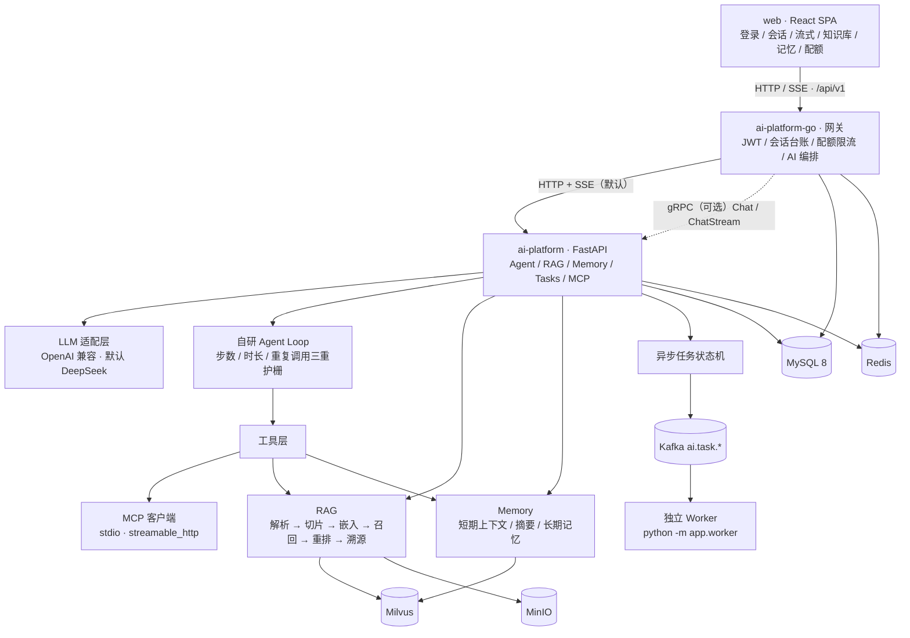

# Personal AI Assistant｜个人智能工作台

> **Web + Go + Python** 全栈 AI 助手：React 前端、Go 网关与消息台账、Python Agent/RAG/Memory/异步任务。
> 前端已从静态原型推进到可真实使用的 F0–F6；联调中发现的后端缺口收敛为 B-01–B-15，全部有可运行闭环。

**导航**：[项目状态](#项目状态) | [前端完成情况](#前端完成情况) | [联调后端优化](#联调后端优化) | [架构](#架构) | [技术栈](#技术栈) | [快速开始](#快速开始) | [验收](#验收) | [文档索引](#文档索引)

## 项目状态

| 模块 | 技术 | 状态 |
| --- | --- | --- |
| [`web`](./web) | Vite 8 + React 19 + TypeScript + TanStack Router/Query + Zustand + Tailwind | ✅ **F0–F6 完成** |
| [`ai-platform-go`](./ai-platform-go) | Go 1.24 / Gin + Kratos（仅 gRPC 拨号）+ MySQL/Redis | ✅ 网关、认证、会话、配额、AI 编排、OpenAPI |
| [`ai-platform`](./ai-platform) | Python 3.12 / FastAPI + Agent Loop + MCP + RAG + Memory | ✅ M1–M8，Kafka Worker 可独立运行 |

当前主链路：

```text
浏览器 → Vite/React → Go 网关 /api/v1 → Python AI 服务 → LLM / Milvus / MySQL / MinIO / Redis
```

默认用 **HTTP + SSE** 衔接；gRPC 只覆盖 `Chat` / `ChatStream`，默认关闭。Go 不持有 Milvus / MinIO / Kafka 客户端。

## 前端完成情况

### F0–F6

| 阶段 | 完成内容 | 关键实现 |
| --- | --- | --- |
| **F0 脚手架** | 登录壳、应用壳、设计令牌、路由、Query、Toast | Vite + React + TS + Tailwind + TanStack Router/Query + Zustand；路由级懒加载 |
| **F1 登录与启动恢复** | 注册/登录/刷新/退出、刷新后恢复、错误码展示 | access 只存内存；refresh 走 HttpOnly Cookie；`refreshOnce` 单飞 + Web Locks；401 只重放一次 |
| **F2 会话与历史** | 55 会话游标分页、消息历史、改名/置顶/归档/删除、侧栏搜索 | `useInfiniteQuery` 游标分页；messages 展平去重；写操作统一失效 `["conversations"]` |
| **F3 流式对话** | 逐字输出、停止、partial 对账、引用、工具轨迹、Markdown/KaTeX | `fetch + ReadableStream`；`stream.ts → parse.ts → reducer.ts → useChatStream` 五层；50ms 批量 flush；45s 看门狗 |
| **F4 知识库与任务** | KB/文档/切片/检索、XHR 上传进度、任务轮询、取消/重试 | 上传 202 后轮询；B-01 起任务 SSE 优先、轮询兜底；文档终态 INDEXED/FAILED |
| **F5 记忆/配额/设置** | 记忆 CRUD、配额/用量、上下文透视、资料/安全/主题 | 记忆设置 dirty 标记；429 按 `retry_after` 倒计时；`X-RateLimit-*` 剩余次数 |
| **F6 质量收口** | 键盘/焦点、错误码动作、500px 移动端、E2E、性能预算 | Modal 焦点陷阱；错误动作表；500px 无横向溢出；首屏 **102.37KB gzip** |

### 前端已实现的关键体验

- **认证**：access 不进 localStorage；刷新页面能恢复；退出/改密清 refresh；错误直接展示后端 `error.message`。
- **会话**：侧栏游标分页、最后消息预览、标题与正文消息双搜索、置顶/归档/删除。
- **对话**：SSE 流式、停止保留 partial、重新生成、删除消息、增量刷新、引用角标与原文、工具调用轨迹。
- **公式**：助手回答支持 `$...$` / `$$...$$`，通过 `remark-math + rehype-katex` 渲染；KaTeX 只在会话页懒加载。
- **知识库**：上传进度、任务状态、切片查看、检索调试、文档附件（已入库文档 ID，最多 5 个）。
- **可用性**：Modal 键盘闭环、移动端 500px、错误码统一动作、429 倒计时、空态/骨架/失败重试。

### 前端验收文档

- 阶段计划：[`ROADMAP.md`](./ROADMAP.md)
- 技术实现总览：[`web/docs/10-前端F0-F6技术实现.md`](./web/docs/10-前端F0-F6技术实现.md)
- 验收记录：F0/F1、F2、F3、F4、F5、F6 分别在 [`web/docs/03`](./web/docs/03-前端F0-F1验收.md)–[`09`](./web/docs/09-前端F6验收.md)
- 联调问题与分类：[`web/docs/05-联调问题记录.md`](./web/docs/05-联调问题记录.md)

## 联调后端优化

前端联调中发现的后端缺口整理为 B-01–B-15。**全部有可运行闭环**；其中 B-03/B-04/B-09/B-10/B-12 为明确范围的 MVP。

| ID | 前端问题 | 后端方案 | 状态 |
| --- | --- | --- | --- |
| B-01 | 任务只能 2s 轮询，进度粗 | 网关新增任务 SSE 透传，前端 SSE + 轮询兜底 | ✅ |
| B-02 | 引用不能回原文 | 文档 download/download-url，302 预签名 + 网关透传 `Location` | ✅ |
| B-03 | 重发会多一条 user、多扣配额 | `regenerate` 复用上一条 user，只写新 assistant | ✅ 非流式 |
| B-04 | 删消息后模型仍记得 | 删台账前同步 AI 上下文，摘要失效、计数扣减 | ✅ 短期上下文 |
| B-05 | 流式结束靠内容匹配对账 | `meta` 补 `user_message_id` / `user_seq` | ✅ |
| B-06 | 自动标题重复，分不清会话 | 会话列表批量返回 `last_message_preview` | ✅ |
| B-07 | 只有 429 后才知道剩余 | `X-RateLimit-*` 响应头 + CORS 暴露 + 前端倒计时 | ✅ |
| B-08 | refresh 在 localStorage 可被 XSS 读 | HttpOnly Cookie 轮换 + SameSite + `Sec-Fetch-Site` | ✅ |
| B-09 | 拖文件进对话不支持 | `attachment_doc_ids`，复用已入库文档 + RAG `doc_ids` | ✅ 文档 ID 附件 |
| B-10 | 只能按标题找历史 | `GET /search/messages?q=`，join 会话 + LIKE + snippet | ✅ LIKE |
| B-11 | 断线/多标签只能整页重拉 | `after_seq` 增量拉取 + 前端增量合并 | ✅ |
| B-12 | 契约手写、易漂移 | `openapi.yaml` 覆盖 42 path + Gin `Routes()` 双向 diff | ✅ 路由级 |
| B-13 | 取消后仍显示 RUNNING | `cancel_requested` 派生字段 + “取消中…” UI | ✅ |
| B-14 | 并发建会话偶发 503 | ID 生成加锁 + 并发唯一性测试 | ✅ |
| B-15 | 关闭记忆后 context/摘要为空 | 短期上下文与 `use_memory` 解耦 | ✅ |

详细方案与“为什么选这个（对比其他方案）”见：

- [`web/docs/02-前端驱动的后端优化清单.md`](./web/docs/02-前端驱动的后端优化清单.md)
- [`web/docs/05-联调问题记录.md`](./web/docs/05-联调问题记录.md) §5

### 范围边界

| 项 | 当前边界 |
| --- | --- |
| B-03 | 非流式重新生成；无 `regenerated_from` 审计字段 |
| B-04 | 只清短期上下文/摘要；长期记忆不自动清 |
| B-09 | 只支持已入库文档 ID；二进制直传未做；gRPC 模式忽略附件 |
| B-10 | LIKE 检索，不是 FULLTEXT/embedding |
| B-12 | 42 path 路由级契约；字段级 schema 只覆盖核心实体 |

## 架构



### 数据权威归属

| 数据 / 能力 | 权威属主 |
| --- | --- |
| 用户、凭据、refresh、会话、消息台账、配额 | **Go** |
| 知识库 / 文档 / 切片元数据、AI 任务、摘要、上下文、长期记忆 | **Python** |
| 原文对象（MinIO）、向量（Milvus）、任务队列（Kafka） | **Python 独占** |

一份数据只有一个属主；Go 对 Python 侧资源只做透传与配额校验，不建副本表。

## 技术栈

### Web

| 层 | 选型 |
| --- | --- |
| 构建 / 框架 | Vite 8、React 19、TypeScript、Tailwind v4 |
| 路由 / 服务端状态 | TanStack Router、TanStack Query v5 |
| 客户端状态 | Zustand（登录态、流式 turn、限流状态） |
| Markdown | `react-markdown + remark-gfm + remark-math + rehype-katex + rehype-sanitize` |
| 流式 | `fetch + ReadableStream + eventsource-parser`，不用 EventSource（POST + Bearer） |
| 测试 | Playwright E2E（F1–F6） |

### Go 网关

Gin 承担全部对外 HTTP/SSE；Kratos 仅用于 gRPC 拨号。GORM + MySQL、Redis 做会话台账/配额/限流，JWT HS256，OpenAPI 42 path 路由契约。

### Python AI 服务

FastAPI 全异步；自研 Agent Loop；MCP stdio/streamable_http；RAG 解析/切分/嵌入/召回/重排；Memory 三层；`none / inline / kafka` 任务执行器；`INFRA_BACKEND=memory|real` 可切换本地内存与真实基础设施。

## 快速开始

### 1. 启动依赖（Docker）

```powershell
# Redis + MinIO
docker compose -f ai-platform/deploy/infra/compose.yml `
  -f ai-platform/deploy/infra/compose.local.yml up -d redis minio

# Kafka（任务隔离档）
docker compose -f ai-platform/deploy/infra/compose.yml --profile kafka up -d

# Milvus 使用独立 standalone；MySQL 使用本机 3306
```

### 2. Python AI 服务

快速本地模式：

```powershell
cd ai-platform
uv sync
Copy-Item .env.example .env
uv run uvicorn app.main:app --host 127.0.0.1 --port 8000
```

真实基础设施 + Kafka Worker：

```powershell
uv sync --extra redis --extra kafka --extra mysql --extra minio
$env:INFRA_BACKEND="real"
$env:TASK_RUNNER="kafka"
uv run uvicorn app.main:app --host 127.0.0.1 --port 8000

# 另开终端
uv run python -m app.worker
```

### 3. Go 网关

```powershell
cd ai-platform-go
Copy-Item .env.example .env       # 填 MYSQL_DSN / JWT_SECRET
go build -o bin/server.exe ./cmd/server
$env:ENV_FILE = "<repo>\ai-platform-go\.env"
.\bin\server.exe                  # 默认 :8080
```

### 4. Web

```powershell
cd web
pnpm install
pnpm dev                          # http://127.0.0.1:3000
```

Vite 代理 `/api → 127.0.0.1:8080`，开发态同源，不需要改 CORS。

## 验收

### 前端

```powershell
cd web
pnpm build        # tsc + vite build
pnpm e2e:f1       # 登录 / 刷新 / 退出 / 失败态
pnpm e2e:f2       # 会话分页 / 历史 / CRUD / 搜索
pnpm e2e:f3       # 流式 / 停止 partial / 刷新对账
pnpm e2e:f4       # KB / 上传 / 切片 / 检索 / 任务
pnpm e2e:f5       # 记忆 / 配额 / 上下文 / 429
pnpm e2e:f6       # 重新生成 / 删除 / Modal 键盘 / 500px
```

当前构建：首屏 **102.37KB gzip**；会话页含 KaTeX 的 chunk 约 **143.72KB gzip**，路由级懒加载。

### 后端

```powershell
cd ai-platform-go
go test ./...

cd ../ai-platform
pytest
```

Go 已覆盖 Gin 路由与 OpenAPI 双向 diff；B-01–B-15 的验收证据汇总在 [`web/docs/05`](./web/docs/05-联调问题记录.md) §5。

## 文档索引

| 文档 | 内容 |
| --- | --- |
| [`ROADMAP.md`](./ROADMAP.md) | 前端 F0–F6 规划、技术实现与验收入口 |
| [`web/README.md`](./web/README.md) | Web 启动、状态、脚本 |
| [`web/docs/01`](./web/docs/01-前端技术选型与代码架构.md) | 前端技术选型与代码架构 |
| [`web/docs/02`](./web/docs/02-前端驱动的后端优化清单.md) | B-01–B-15：问题 / 方案 / 为什么选它 / 边界 |
| [`web/docs/05`](./web/docs/05-联调问题记录.md) | I 问题分类、详情、B 项归档 |
| [`web/docs/10`](./web/docs/10-前端F0-F6技术实现.md) | 每个阶段的实现细节 |
| [`ai-platform-go/docs/openapi.yaml`](./ai-platform-go/docs/openapi.yaml) | 42 path 网关 OpenAPI |
| [`ai-platform-go/docs/08`](./ai-platform-go/docs/08-实现进度与运行手册.md) | Go 实现进度、环境与验收 |
| [`ai-platform/docs/13`](./ai-platform/docs/13-技术设计说明.md) | Python 技术设计与扩展点 |

## 边界与后续

已完成的是**可运行闭环**，不是所有能力的生产全量版：

- B-03 非流式；B-04 只清短期上下文；B-09 只做文档 ID 附件；B-10 只做 LIKE；B-12 只锁路由级契约。
- 没有 CI、Kubernetes 清单；没有检索评测集；MCP `prompts` / `sampling` 按 SRS 不做。
- 长驻 Python gRPC 进程的历史长稳问题仍在运维上按定期重启兜底，根因未定位。

后续优先补：检索评测集、字段级 OpenAPI/codegen、附件二进制直传、CI + 部署清单。
