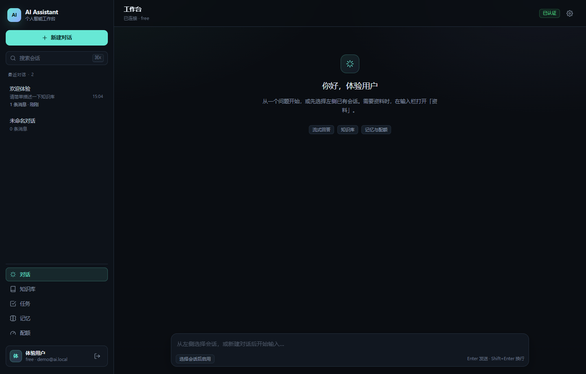
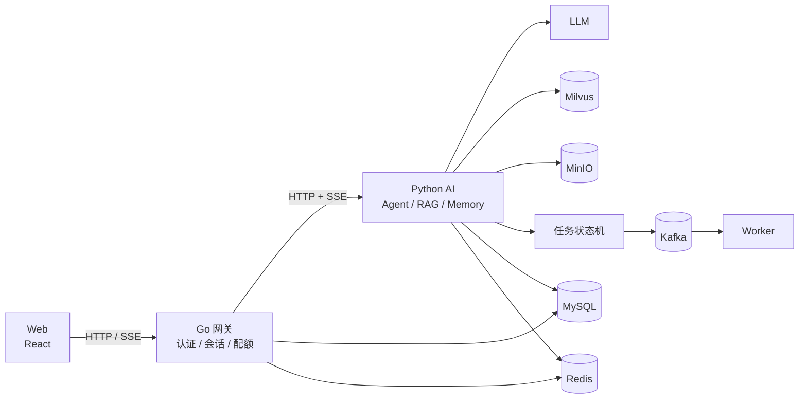

# Personal AI Assistant｜个人智能工作台

一个面向个人知识工作的全栈 AI 助手：把**对话、知识库、长期记忆、配额与工具调用**放在同一个工作台里。  
Web 负责可读可操作的界面，Go 负责身份、会话台账与配额，Python 负责 Agent、RAG、Memory 与异步任务。



## 技术栈

<p>
  
  &nbsp;
  
  &nbsp;
  
  &nbsp;
  
  &nbsp;
  
  &nbsp;
  
  &nbsp;
  
  &nbsp;
  
  &nbsp;
  
  &nbsp;
  
  &nbsp;
  
</p>

| 层 | 主要技术 |
| --- | --- |
| **Web** | React 19 · TypeScript · Vite 8 · Tailwind CSS v4 · TanStack Router / Query · Zustand · react-markdown · KaTeX |
| **Go 网关** | Go 1.24 · Gin · Kratos（仅 gRPC 拨号）· GORM · JWT / argon2id · Redis · MySQL |
| **Python AI** | Python 3.12 · FastAPI · OpenAI 兼容 LLM · 自研 Agent Loop · MCP · Milvus · MinIO · Kafka |
| **基础设施** | Docker Compose · MySQL · Redis · Kafka · Milvus · MinIO |

## 代码结构

```text
ai-assistant/
├─ web/                        # React 前端
│  ├─ src/
│  │  ├─ app/                  # 路由、应用壳、QueryClient
│  │  ├─ features/             # 业务模块
│  │  │  ├─ auth/              # 登录、注册、启动恢复
│  │  │  ├─ conversations/     # 会话列表、搜索
│  │  │  ├─ messages/          # 消息分页、删除、重新生成
│  │  │  ├─ chat/              # 对话页、SSE 流式、引用、工具轨迹
│  │  │  ├─ knowledge/         # 知识库、文档、切片、检索
│  │  │  ├─ tasks/             # 异步任务、进度
│  │  │  ├─ memory/            # 长期记忆
│  │  │  ├─ quota/             # 配额与用量
│  │  │  └─ settings/          # 资料、安全、主题
│  │  └─ shared/               # API 客户端、通用 UI、工具函数
│  ├─ docs/                    # 前端设计与技术文档
│  ├─ e2e/                     # 浏览器端到端脚本
│  └─ prototype/               # 静态视觉原型
│
├─ ai-platform-go/             # Go 网关
│  ├─ cmd/server/              # HTTP 服务入口
│  ├─ internal/
│  │  ├─ server/               # 路由、中间件、SSE
│  │  ├─ service/              # 接口层：认证、会话、消息、代理
│  │  ├─ biz/                  # 业务层：用户、会话、配额、消息流
│  │  ├─ data/                 # MySQL / Redis / AI 客户端
│  │  └─ conf/                 # 配置加载
│  ├─ docs/openapi.yaml        # 网关 API 契约
│  └─ deploy/mysql/            # 网关数据库脚本
│
├─ ai-platform/                # Python AI 服务
│  ├─ app/
│  │  ├─ api/                  # FastAPI 路由
│  │  ├─ application/          # 对话、Agent、Memory 用例编排
│  │  ├─ agent/                # 自研 Agent Loop
│  │  ├─ tools/                # 工具注册与执行
│  │  ├─ mcp/                  # MCP 客户端
│  │  ├─ rag/                  # 解析、切片、嵌入、召回、重排
│  │  ├─ memory/               # 短期上下文、摘要、长期记忆
│  │  └─ tasks/                # 任务状态机、Worker、事件
│  ├─ tests/                   # 单元 / 契约 / 集成测试
│  └─ deploy/infra/            # Redis / Kafka / MinIO Compose
│
├─ tools/                      # 本地验证与基准脚本
└─ ROADMAP.md                  # 前端阶段规划
```

## 业务模块

### 1. 认证与用户

- 注册、登录、刷新、退出、修改密码
- access token 只存内存，refresh 走 HttpOnly Cookie
- 用户资料、主题偏好、套餐与配额展示

主要位置：`web/src/features/auth`、`ai-platform-go/internal/service/auth.go`、`ai-platform-go/internal/biz/auth.go`

### 2. 会话与消息

- 会话新建、重命名、置顶、归档、删除
- 消息游标分页、历史恢复、单条删除、重新生成
- 侧栏按标题与消息内容搜索
- 会话级知识库绑定与增量刷新

主要位置：`web/src/features/conversations`、`web/src/features/messages`、`ai-platform-go/internal/biz/conversation.go`、`message.go`

### 3. 对话与 Agent

- SSE 流式回答、停止生成、partial 对账
- Markdown、代码块、引用角标、KaTeX 公式
- 工具调用轨迹、上下文预算与裁剪
- 自研 Agent Loop：推理 → 工具调用 → 结果回注 → 再推理
- MCP stdio / streamable_http 工具接入

主要位置：`web/src/features/chat`、`ai-platform/app/application/chat.py`、`ai-platform/app/agent/loop.py`

### 4. 知识库与 RAG

- 知识库与文档 CRUD
- 上传进度、任务状态、文档切片查看
- 检索调试、引用原文、聊天附件
- 文档解析 → 结构感知切分 → Embedding → Milvus
- 召回 → 相邻合并 → 重排 → 来源引用

主要位置：`web/src/features/knowledge`、`ai-platform/app/rag/`、`ai-platform/app/api/v1/documents.py`

### 5. 异步任务

- 任务状态机、进度查询
- 任务 SSE 进度流，轮询兜底
- 取消、失败重试、取消中状态
- `inline` 单进程执行 / `kafka` 独立 Worker 执行

主要位置：`web/src/features/tasks`、`ai-platform/app/tasks/`、`ai-platform/app/worker/`

### 6. 记忆

- 长期记忆新增、编辑、删除、筛选、开关
- 短期上下文、摘要压缩、长期记忆三层
- 上下文透视：预算、裁剪项、摘要、消息
- 记忆设置与清空二次确认

主要位置：`web/src/features/memory`、`ai-platform/app/memory/`、`ai-platform/app/application/memory.py`

### 7. 配额与限流

- 6 维配额：请求数、token、知识库、文档、存储、并发
- 用量统计与仪表盘
- 限流剩余次数、429 倒计时、发送禁用
- 网关配额预扣、回滚与限流中间件

主要位置：`web/src/features/quota`、`ai-platform-go/internal/biz/ratelimit.go`、`ai-platform-go/internal/server/middleware/ratelimit.go`

### 8. 可观测与运维

- 健康检查：`/health/live`、`/health/ready`
- Prometheus 指标、OpenTelemetry Trace
- 请求日志、错误信封、trace_id
- Docker Compose 本地基础设施

主要位置：`ai-platform-go/internal/service/health.go`、`ai-platform/app/infrastructure/observability/`

## 核心链路



## 快速启动

```powershell
# 1. 基础设施
docker compose -f ai-platform/deploy/infra/compose.yml `
  -f ai-platform/deploy/infra/compose.local.yml up -d redis minio

# 2. Python AI
cd ai-platform
uv sync
Copy-Item .env.example .env
uv run uvicorn app.main:app --host 127.0.0.1 --port 8000

# 3. Go 网关
cd ../ai-platform-go
Copy-Item .env.example .env
go run ./cmd/server

# 4. Web
cd ../web
pnpm install
pnpm dev
```

打开：

```text
Web       http://127.0.0.1:3000
Gateway   http://127.0.0.1:8080
AI API    http://127.0.0.1:8000/docs
```

## 文档

| 文档 | 内容 |
| --- | --- |
| [`web/docs/01`](./web/docs/01-前端技术选型与代码架构.md) | 前端选型与架构 |
| [`web/docs/10`](./web/docs/10-前端F0-F6技术实现.md) | 前端各模块实现细节 |
| [`ai-platform-go/docs/openapi.yaml`](./ai-platform-go/docs/openapi.yaml) | 网关 API 契约 |
| [`ai-platform/docs/13`](./ai-platform/docs/13-技术设计说明.md) | Python 技术设计 |
| [`ai-platform/README.md`](./ai-platform/README.md) | AI 服务接口与运行说明 |
| [`ai-platform-go/README.md`](./ai-platform-go/README.md) | 网关架构与数据归属 |
