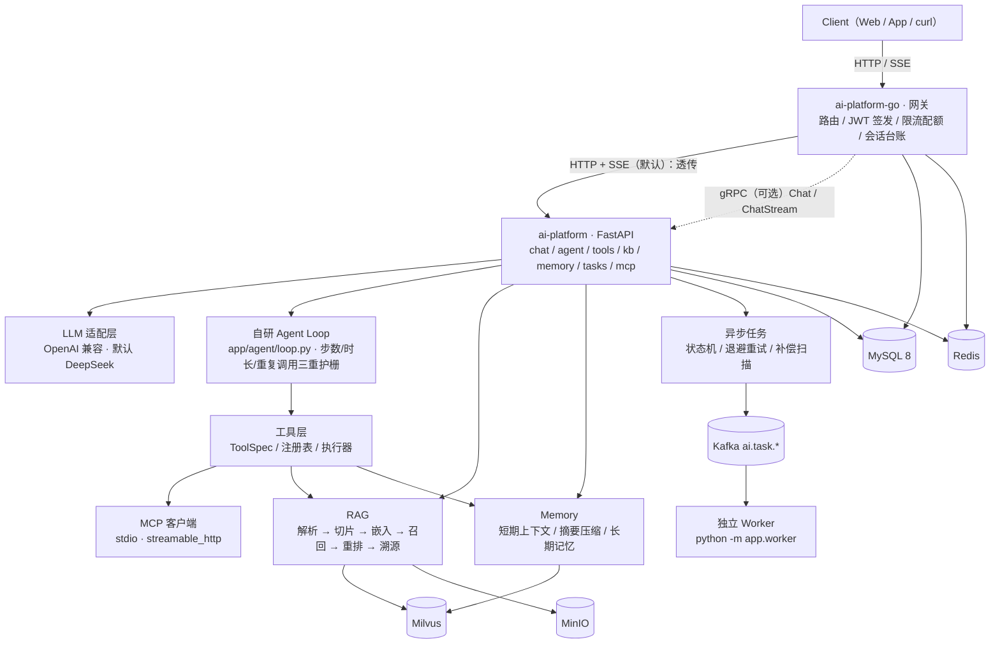

# Personal AI Assistant｜个人智能 Agent 平台

> **Go + Python** 两段式：Go 侧是网关与台账（鉴权、会话消息、配额限流、AI 调用编排），
> Python 侧是 LLM 应用能力（自研 Agent Loop、工具与 MCP、RAG、Memory、异步任务）。
> 两侧按「**一份数据只有一个权威属主**」切分，默认用 HTTP + SSE 衔接，
> gRPC 只覆盖 `Chat` / `ChatStream` 且默认关闭 —— 目的就是让 AI 服务**独立启动、独立压测、独立验收**。

**简介** | [定位](#定位与分层) | [架构](#架构) | [技术栈](#技术栈) | [已实现能力](#已实现能力) | [质量门禁](#质量门禁) | [关键取舍](#关键取舍) | [快速开始](#快速开始) | [文档索引](#文档索引) | [现状与差距](#现状与差距)

## 定位与分层

| 子项目 | 语言 / 框架 | 职责 | 状态 |
| --- | --- | --- | --- |
| [`ai-platform`](./ai-platform) | Python 3.12 / FastAPI + LangChain | LLM 编排、自研 Agent Loop、工具与 MCP、RAG、Memory、异步任务、可观测 | ✅ 已交付（M1–M8） |
| [`ai-platform-go`](./ai-platform-go) | Go 1.24 / Gin + Kratos（**仅**用于 gRPC 拨号） | 对外网关、用户与鉴权、会话与消息台账、AI 编排、配额限流 | ✅ 已交付（M1–M6） |

衔接方式：默认 **HTTP + SSE** —— 网关把知识库 / 文档 / 上传 / 记忆 / 工具 / MCP / 任务等接口按字节透传，并做断连传播；
gRPC 只提供 `Chat` / `ChatStream` 两个方法，`GRPC_ENABLED=false` 时 Python 根本不监听 50051。

## 架构



图里没有 `langgraph`：设计初期考虑过 LangGraph 状态图，最终未采用，
真正在跑的是 `app/agent/loop.py` 的自研循环。三条与图对应的实现事实：

- **对外 HTTP / SSE 全部由 Gin 承担**；Kratos v2.8.4 只在 `internal/data/ai/grpc.go` 里做 `kratosgrpc.DialInsecure`，
  并显式 `WithTimeout(0)` + 关闭健康检查（Kratos 默认会给每次调用套 2s 超时，见 [`docs/08`](./ai-platform-go/docs/08-实现进度与运行手册.md) §6.4-1）。
- **没有 CI、没有 Kubernetes 清单**；`docker compose` 只起本地基础设施与可观测栈。
- **没有 Nacos 实现**：Go 侧 `AI_DISCOVERY_ENABLED=false` 直连 AI 服务，配置只来自 `.env`。

## 数据权威归属

一份数据只有一个属主，越界是最贵的错误。完整表见 [`ai-platform-go/README.md`](./ai-platform-go/README.md) §1.2。

| 数据 / 能力 | 权威属主 | 说明 |
| --- | --- | --- |
| 用户、凭据、刷新令牌 | **Go** | Python 只读 JWT 的 `sub` 当 `user_id`，不建用户表 |
| 会话 `conversation`、消息台账 `message` | **Go** | Python 只持 `conversation_id` 引用，不建表 |
| 对话摘要、短期上下文 `ctx:{id}`、长期记忆 | **Python** | Go 只透传，不碰该 Key 空间 |
| 知识库 / 文档 / 切片元数据、AI 任务 `task` | **Python** | Go 不建任务副本表（`REQ-ORCH-007`），只透传 + 配额校验 |
| 原始文件（MinIO）、向量（Milvus）、队列（Kafka） | **Python 独占** | Go 侧不引入这三个客户端 |
| 配额、用量、计费 | **Go** | Python 只上报 `usage`，不扣减 |

两侧共用同一个 MySQL 库（`ai_platform`，合计 15 张表），但每张表只有一个建表脚本来源：
AI 独占 7 张 + 共享 2 张在 [`ai-platform/deploy/mysql`](./ai-platform/deploy/mysql)，
网关独占 6 张在 [`ai-platform-go/deploy/mysql`](./ai-platform-go/deploy/mysql)。

## 技术栈

### Go 网关（`ai-platform-go`）

下表按 `go.mod` 的直接依赖与代码实际引用核对，不是设计文档的愿望清单。

| 层 | 选型与约束 |
| --- | --- |
| 语言 | **Go 1.24**（`go.mod` 固定 `go 1.24.0`）。**不要上调该行**：会触发 `GOTOOLCHAIN=auto` 联网下载新工具链，并连带要求升级 `x/crypto` / `x/net` / `gin` |
| 对外 HTTP / SSE | **Gin v1.11.0** 承担全部路由、中间件链、错误信封与 SSE |
| 对内 gRPC | **Kratos v2.8.4**，仅 `Chat` / `ChatStream` 拨号；不存在「Gin 套 Kratos HTTP server」，也不存在 Kratos 注册发现 |
| 数据 / 缓存 | GORM v1.31.2 + `driver/mysql`；`redis/go-redis/v9` v9.22.0（Key 前缀与 Python 的 `ctx:` / `lock:` / `rate:` 不重名） |
| 鉴权 / ID | `golang-jwt/jwt/v5` v5.3.1（HS256，网关签发、Python 只校验）、argon2id（`x/crypto`）、`oklog/ulid/v2` |
| 配置 | `joho/godotenv` + 环境变量（`ENV_FILE` 指绝对路径，启动时校验）；**未引入** viper / YAML / Nacos |
| 可观测 | OTel Go SDK v1.31.0（OTLP/gRPC）+ Prometheus client_golang v1.21.1，27 个 `gw_*` 指标；指标走独立端口，主应用不暴露 `/metrics` |
| 测试 | 标准库 `testing`：30 个 `*_test.go` / 234 个 `Test*`；**未引入** testify 与 testcontainers-go，真基础设施用例靠 `GW_LIVE_REDIS` 等环境变量开启 |

### Python AI 服务（`ai-platform`）

| 层 | 选型与约束 |
| --- | --- |
| 语言 | **Python 3.12**（`.python-version` 固定：`torch` / `transformers` / `FlagEmbedding` 对更高版本适配不全） |
| Web / 配置 | FastAPI + Uvicorn（全异步，`create_app(settings)` 支持注入配置）；Pydantic v2 + pydantic-settings，配置唯一来源 `app/core/config.py`，启动期 `validate_for_startup()` |
| LLM 编排 | 主链路是**自研 Agent Loop**；设计初期考虑过 LangGraph 状态图，最终未采用。`langgraph` 已不是直接依赖，仅随 `langchain` 传递安装 |
| LLM 供应商 | OpenAI 兼容协议，默认 DeepSeek；换 Moonshot / 百炼 / 本地 vLLM 只改 `base_url` + 模型名 |
| 嵌入 | 四档 `EMBEDDING_PROVIDER=siliconflow\|ark\|bge\|hash`。出厂 `siliconflow`（`Qwen/Qwen3-Embedding-0.6B`，1024 维，不占本机算力）；`bge` 本地档 `BAAI/bge-m3`；`hash` 为测试用零依赖词法向量 |
| 重排 | 两档 `RERANKER_PROVIDER=siliconflow\|bge`（显式枚举，早期按模型名猜会静默退化成不重排）。云端 `Qwen/Qwen3-Reranker-0.6B` 20 条候选 320ms；本地 `bge-reranker-v2-m3` 同条件 70~83s（CPU，不可上线） |
| 向量库 | Milvus（PyMilvus + `langchain-milvus`）：知识库切片集合 + 长期记忆集合，HNSW/COSINE + 标量倒排索引支撑多租户过滤 |
| 存储 / 队列 / 对象 | MySQL 8（SQLAlchemy Core + asyncmy）、Redis（LTRIM + TTL、幂等键、退避重试 ZSET、pub/sub）、Kafka（aiokafka）、MinIO |
| 工具 / 流式 | MCP Python SDK（stdio + streamable_http，命名空间 `mcp__{server}__{tool}`）；SSE 自研帧构造 + 心跳 + 断连收尾 |
| 对内 gRPC | grpcio / grpcio-tools，`python -m app.grpc` 实现 `Chat` / `ChatStream`；默认 `GRPC_ENABLED=false` 且只听回环，容器里要显式改 |
| 可观测 | OTel SDK → Jaeger（trace id 与日志、响应头同值）+ Prometheus Client，19 个 `ai_*` 指标，独立指标端口 |
| 依赖 / 质量 | uv（`uv.lock` 锁定，`--extra redis/kafka/mysql/minio` 按需装可选依赖；本地向量化/重排在 `--extra local-ml`）+ ruff / mypy / pytest(asyncio、cov) |

- 本地基础设施：`docker compose`（Redis · Kafka `--profile kafka` · MySQL · Milvus · MinIO · Jaeger · Prometheus · Grafana）。
- 契约真源：`ai-platform-go/proto/aiplatform/v1/chat.proto`，两侧各自生成；生成物不手改，也不参与 lint。

## 已实现能力

### Go 网关（`ai-platform-go`）

- **认证与用户**：注册 / 登录 / 刷新 / 登出，argon2id 口令哈希，JWT（HS256）签发，刷新令牌轮换（旧令牌重放即失效），改密后旧令牌按版本号失效。
- **会话与消息台账**：会话 CRUD / 归档 / 软删除 / 自动标题；消息按 `seq` 单调递增落库，是**消息事实的唯一属主**。
- **AI 调用编排**：`Chat` 走 gRPC 一元、`ChatStream` 走服务端流；网关负责首帧改写（`conversation_id` / `message_id` 由 Go 生成）、断连传播、`partial` 落库。
- **字节级透传**：知识库 / 文档 / 上传 / 记忆 / 工具 / MCP / 任务 / 模型接口按 HTTP 透传给 `ai-platform`，透传前做配额校验；网关**不引入** Milvus / MinIO / Kafka 客户端。
- **配额与限流**：5 维限流 + 配额预扣与回滚 + 三态熔断器；`413` 由 `Content-Length` 判定、不读请求体；伪造 `X-Forwarded-For` 仍会被限流。
- **中间件链**（顺序固定）：`recovery → trace/otel → logging → metrics → cors → 幂等键 → 鉴权 → 限流`。
- **可观测**：OTel 尾采样、`gw_*` 指标独立端口、日志脱敏、retention 定时任务。

### Python AI 服务（`ai-platform`）

- **对话与流式**：`POST /chat` 与 `POST /chat/stream`（SSE：`meta → reference* → token* → usage → done`）；上下文按 `system → memory → summary → history → rag → query` 确定性装配并在 token 预算内裁剪；回答里的 `[n]` 与 `references[].index` 打通**来源溯源**。细节见 [`docs/13`](./ai-platform/docs/13-技术设计说明.md) §6。
- **Agent Loop**：`app/agent/loop.py` 实现「推理 → 工具调用 → 结果回注 → 再推理」，带**步数 / 总时长 / 重复调用**三重护栅，产出完整 `tool_calls` 轨迹与降级原因；`use_tools=true` 时对话请求自动转交 Agent 链路。
- **工具层**：`ToolSpec` + 注册表（重名 fail-fast）+ 执行器（读并发 / 写串行、超时、结果截断、错误归一）+ 6 个内置工具（`kb_retrieve` / `calculator` / `current_time` / `http_fetch` / `memory_save` / `memory_search`）；参数以 pydantic 模型为单一事实来源，**参数不合法作为「可回复的结果」回注给模型而非 5xx**。
- **MCP 接入**：配置校验（`${VAR}` 展开、未知字段报错）、`stdio` 与 `streamable_http` 两种传输、多 Server 并发启动 + 总超时、单 Server 状态机（懒重连 + 行内熔断）、命名空间与 allow/deny 名单、`write_tools` 审计。
- **RAG**：写路径 = 扩展名 + 魔数双校验 → 解析 → 结构感知切分（表格 / 代码块 atomic）→ 嵌入 → 落 Milvus + MySQL；读路径 = 召回 `top_k=20` → 合并相邻 → 重排 `top_n=5` → 预算裁剪，重排失败一律降级（`applied=false`）而不 500。切分细节见 [`docs/13`](./ai-platform/docs/13-技术设计说明.md) §7。
- **Memory 三层**：短期上下文（内存 / Redis 两套实现、LTRIM + TTL、分布式锁、摘要覆盖过滤）、摘要压缩（四段结构 / 增量合并 / 5 分钟防抖）、长期记忆（哈希 + 语义双层去重、`0.85/0.92` 双阈值、过期与清空冷静期、独立 system 段注入）。
- **异步任务**：显式迁移白名单的状态机 + 幂等键 + 乐观锁；`none` / `inline` / `kafka` 三个执行器由装配期决定；ZSET 退避重试（Lua 原子认领）+ 30s 补偿扫描 + 独立 Worker 进程（配置错时拒绝启动）+ `GET /tasks/{id}/events`（SSE 进度流：快照 + 增量 + 心跳）。
- **可观测与降级**：19 个 `ai_*` 指标（`endpoint` 标签取**路由模板**，无高基数字段）、独立指标端口、熔断器状态机；`INFRA_BACKEND=memory|real` 决定基础设施形态，`real` 下某依赖初始化失败**不会让服务起不来**，对应仓储降级为 `503 DEPENDENCY_UNAVAILABLE`。

规模口径：`ai-platform` 共 **41 条 HTTP 路由**（`app/api/**` 的 41 个 `@router.*`），接口表见 [`ai-platform/README.md`](./ai-platform/README.md)；
Go 侧 `internal/server/http.go` 有 **58 处路由注册**，分组清单见 [`ai-platform-go/docs/08`](./ai-platform-go/docs/08-实现进度与运行手册.md)。

## 质量门禁

以下数字均为本机（Windows / PowerShell）实测，命令与输出摘要一并给出；Python 部分在 `ai-platform/` 下执行，Go 部分在 `ai-platform-go/` 下执行。

### Python（`ai-platform`）

| 命令 | 实测结果 |
| --- | --- |
| `ruff format --check .` | `232 files already formatted`（exit 0） |
| `ruff check .` | `All checks passed!`（exit 0） |
| `mypy app` | `Success: no issues found in 147 source files`（exit 0） |
| `pytest` | **1698 collected / 1688 passed / 10 skipped / 0 failed**，112.8 s |
| `pytest --cov=app` | **89%**（11561 语句 / 1315 未覆盖；门槛 70%） |

> 本次未启动 Redis / MySQL / Milvus / MinIO，10 个 `@pytest.mark.integration` 用例按设计跳过（不可达时 1 秒内 skip），覆盖率 89% 亦受此影响，接上真基础设施会回升。

测试分层：`tests/unit`（纯逻辑）、`tests/contract`（接口契约，默认跑）、`tests/integration`（真基础设施，不可达即 skip）。
外部依赖一律走替身（`tests/support/`：脚本化 LLM、确定性向量化、假 MCP Server），所以「片段顺序」「断连是否停掉上游」「熔断是否真的打开」这类行为都能被机械断言，不靠人眼看日志。

### Go（`ai-platform-go`）

| 命令 | 实测结果 |
| --- | --- |
| `gofmt -l .` | 无输出（无文件需要格式化） |
| `go build ./...` | exit 0 |
| `go vet ./...` | exit 0 |
| `go test ./...` | 全部包 `ok`，21.1 s，exit 0 |

规模：**93** 个非测试 `.go` 源文件 + **30** 个 `*_test.go` / **234** 个 `Test*`；`internal/` **5** 层（`biz` / `conf` / `data` / `server` / `service`），`pkg/` **11** 个可复用包。

> `go test ./...` 默认只跑不需要外部依赖的用例，真 Redis / MySQL 用例由 `GW_LIVE_REDIS` 等开关控制；接口级验收（`tools/curl_stage1..6.ps1`）需同时起两侧服务与基础设施，本次未执行，历史结果见 [`docs/08`](./ai-platform-go/docs/08-实现进度与运行手册.md) §9。

## 关键取舍

| 决策 | 选择 | 备选 | 理由与代价 |
| --- | --- | --- | --- |
| Agent 编排 | **自研 Agent Loop**（`app/agent/loop.py`） | LangGraph 状态图（设计初期备选） | 三重护栅、`tool_calls` 轨迹与降级原因都可被单测断言；LangGraph 最终未采用，状态图没有落地 |
| 向量库 | **Milvus**（HNSW + COSINE + 标量倒排索引） | Qdrant（设计原选） | 与 `langchain-milvus` 集成更顺且本机已验证；代价是多带 etcd + 自带 MinIO 的运维 |
| 内部通信 | **HTTP + SSE 默认**，gRPC 仅 `Chat` / `ChatStream` | 全量 gRPC | 少一层 proto 维护，SSE 天然适合流式透传，取消用连接断开表达；代价是两套客户端各自维护 |
| 微服务拆分 | Go 侧**单进程多模块** | User / Conversation / Task 三个服务 | 三者共享同一 MySQL 事务边界，拆进程只引入分布式事务而无收益 |
| 对外 HTTP 框架 | **Gin** | Kratos HTTP server | 避免「Gin 套在 Kratos HTTP server 上」的叠加复杂度；Kratos 只借其 gRPC 拨号 |
| 嵌入模型 | **云端硅基流动 `Qwen/Qwen3-Embedding-0.6B`**（1024 维） | 本地 BGE / 方舟多模态 | 本地档 CPU 上 8MB 需 70~100min；代价是按 token 计费，且**provider 再快，串行等待也只剩 1 个请求在飞**（实测 98.2s → 窗口 8 = 40.4s） |
| 切分合并 | 合并填到 `chunk_size`（`MERGE_FILL_RATIO=1.0`） | 停在 `0.3 × chunk_size` | 前者消除 41% 正文丢失（片数 16,969 → 6,056）；**代价是每 token 向量化成本 +26~28%** |
| 任务隔离 | **独立 Worker（`kafka`）为出厂档** | `inline` 内联 | 大文件不再抢在线请求的 CPU；代价是多一个必须先起的进程，不启就永远 `QUEUED` |
| 限流 | **双维度（IP + 账号）** | 单维度 | 只按 IP 挡不住分布式撞库，只按账号可被「多账号分散累加」绕过 |
| 幂等 | 幂等键中间件，**仅写接口** | 全接口 | 读接口天然幂等、归档删除本身幂等，挂上去只有成本 |

## 快速开始

### 1. Python AI 服务

```powershell
# 前置：Python 3.12（.python-version 固定，uv 自动托管）+ uv ≥ 0.5
cd ai-platform
uv sync                                  # 按 uv.lock 建 .venv（默认档，不含本地 ML 4 件套）
Copy-Item .env.example .env              # 至少填真实的 OPENAI_API_KEY（默认用 DeepSeek）
uv run uvicorn app.main:app --reload     # 代码默认 INFRA_BACKEND=memory：无外部依赖即可跑通
# Swagger UI  http://127.0.0.1:8000/docs
# 健康检查    http://127.0.0.1:8000/api/v1/health
```

> `torch` / `transformers` / `sentence-transformers` / `flagembedding` 收在 `local-ml` extra 里
> （解包 ~800 MB，且会让 `import app.main` 从 2.5 s 变成 17 s）。只有用本地向量化/重排
> （`EMBEDDING_PROVIDER=bge`）时才 `uv sync --extra local-ml`；没装时是**首次调用**返回
> `503 DEPENDENCY_UNAVAILABLE`，不影响启动。

切真实基础设施（Redis / MySQL / Milvus / MinIO / Kafka）与独立 Worker：

> MySQL 口令不入库：`real` 档要显式给 `MYSQL_DSN`（代码默认值只保留连接串结构、口令为空），
> 例：`$env:MYSQL_DSN="mysql+asyncmy://root:<你的口令>@localhost:3306/ai_platform"`；
> Go 网关侧同理，用 `MYSQL_DSN`（`ai-platform-go/.env`）。

```powershell
uv sync --extra redis --extra kafka --extra mysql --extra minio
docker compose -f deploy/infra/compose.yml up -d redis            # 任务仓储 / 事件总线 / 重试队列
docker compose -f deploy/infra/compose.yml --profile kafka up -d  # 单节点 Kafka
$env:TASK_RUNNER="kafka"                                           # 隔离档：在线请求与入库解耦
uv run uvicorn app.main:app --reload
uv run python -m app.worker                                        # 另开终端；不启则任务永远 QUEUED
```

开对内 gRPC（供 Go 网关的 `Chat` / `ChatStream`）：

```powershell
$env:GRPC_ENABLED="true"     # 默认 false，未开启时 python -m app.grpc 以退出码 2 报错
$env:GRPC_HOST="127.0.0.1"   # 默认只听回环；容器里要显式改
uv run python -m app.grpc    # 默认端口 50051
```

### 2. Go 网关

```powershell
cd ai-platform-go
mysql --default-character-set=utf8mb4 -u root -p -e "source deploy/mysql/001_gateway_tables.sql"
mysql --default-character-set=utf8mb4 -u root -p -e "source deploy/mysql/002_test_accounts.sql"
Copy-Item .env.example .env       # 至少填 MYSQL_DSN / JWT_SECRET
go build -o bin/server.exe ./cmd/server
$env:ENV_FILE = "<repo>\ai-platform-go\.env"
.\bin\server.exe                  # HTTP_ADDR 默认 0.0.0.0:8080；指标走独立 METRICS_PORT
```

自检（不需要外部依赖）：

```powershell
gofmt -l .   # 期望无输出
go build ./...
go vet ./...
go test ./...
```

> `INFRA_BACKEND=memory`（代码默认）时 Python 侧全部存储走进程内实现，单进程即可跑通；
> `Copy-Item .env.example .env` 得到的出厂档是 `real` + `TASK_RUNNER=kafka`（隔离档），此时必须先起基础设施与 Worker。
> `real` 下任一外部依赖初始化失败不会阻断启动，对应仓储返回 `503 DEPENDENCY_UNAVAILABLE`。
> 接口级示例见 [`docs/14-接口 curl 示例.md`](./ai-platform/docs/14-接口%20curl%20示例.md)。

## 文档索引

按「需求 → 实现 → 故障 → 设计 → 实测」阅读：

| 阶段 | 文档 | 内容 |
| --- | --- | --- |
| 需求 | [`ai-platform/docs/01`–`11`](./ai-platform/docs) | Python 侧 SRS：总体 · 接口与错误码 · 对话流式 · Agent 与工具 · MCP · RAG · Memory · 异步任务 · 数据模型 · 非功能与可观测 · 验收标准 |
| 需求 | [`ai-platform/docs/README.md`](./ai-platform/docs/README.md) | Python 侧 SRS 总览：范围边界、阅读路径、**现状与差距** |
| 需求 | [`ai-platform-go/docs/01`–`07`](./ai-platform-go/docs) | Go 侧 SRS：总体 · 接口与鉴权 · 用户与会话 · AI 编排与网关 · 数据模型 · 非功能 · 验收标准 |
| 实现 | [`ai-platform/README.md`](./ai-platform/README.md) | Python 侧总览 + 完整接口表 |
| 实现 | [`ai-platform-go/README.md`](./ai-platform-go/README.md) | Go 侧总览、**数据权威归属表**（§1.2）、选型说明 |
| 实现 | [`ai-platform-go/docs/08`](./ai-platform-go/docs/08-实现进度与运行手册.md) | 逐阶段实现进度、环境与运行手册、验收结果、**实现期缺陷与根因** |
| 故障 | [`ai-platform/docs/12-实现问题记录.md`](./ai-platform/docs/12-实现问题记录.md) | 故障史：症状 / 根因 / 修法 / **留下的那道防线** |
| 设计 | [`ai-platform/docs/13-技术设计说明.md`](./ai-platform/docs/13-技术设计说明.md) | 分层、装配、错误处理、各链路设计、扩展点与已知取舍 |
| 设计 | [`ai-platform/Python项目代码调整规范.md`](./ai-platform/Python项目代码调整规范.md) | 代码改动纪律与**注释规范**（原 `docs/15-代码注释规范.md` 不存在，其内容并入此文件） |
| 实测 | [`ai-platform/docs/14-接口 curl 示例.md`](./ai-platform/docs/14-接口%20curl%20示例.md) | 每个接口的 curl 命令 + 真实响应（含 409 / 404 负例）+ 一键验证脚本 |
| 实测 | [`ai-platform-go/docs/09-优化清单与实测记录.md`](./ai-platform-go/docs/09-优化清单与实测记录.md) | 耗时归因 + OPT-01~10 / UP-01~10 清单 + 本机实测数字、复现命令，以及**与预期不符的结论** |

## 现状与差距

### 未完成项

1. **没有 CI，也没有 Kubernetes 清单**：仓库内只有 Docker Compose（本地基础设施 + 可观测栈）；部署形态（Deployment + Service）是设计目标，不是既成事实。
2. **没有检索评测集**：改切分、换 embedding、调 `MERGE_FILL_RATIO` 都缺量化验收手段，是当前最大的流程缺口。
3. **MCP 的 `prompts` / `sampling` 按 SRS 明示不做**；设计初期考虑过 LangGraph 状态图，最终未采用，Agent 主链路是自研 Agent Loop。
4. **网关侧未做**：`GET /audit-logs` 只落库不提供查询；容器化与 `SIGTERM` 实机验收缺席（Windows 不提供 `SIGTERM`）；对记忆 / 工具 / MCP 只做透传，不含本土逻辑。
5. **一处已知长期缺陷**：长驻的 Python gRPC 进程跑约 3 小时后，所有 `Chat` 退化为 `503 DEPENDENCY_UNAVAILABLE`（Python 直连探测同样失败，可排除网关），**重启进程即恢复**；根因未定位，运维上按定期重启兜底（[`docs/08`](./ai-platform-go/docs/08-实现进度与运行手册.md) §6.4-4）。

### 文档与实现的口径不一致

以下以**代码与本文实测数字**为准，待回写文档：

| 项 | 文档口径 | 实际情况 |
| --- | --- | --- |
| Go 测试依赖 | `ai-platform-go/README.md` §2 列了 `testify` + `testcontainers-go`，并称有 Nacos 注册发现 | `go.mod` 中**没有** Nacos SDK、`testcontainers-go`、`testify`；`validator` 只是 Gin 的间接依赖、项目代码 0 处引用；Nacos 只有配置字段，无实现（`AI_DISCOVERY_ENABLED=false` 直连） |
| Go 路由条数 | 59 条（6 健康 + 53 业务） | `internal/server/http.go` 有 **58 处**路由注册；健康检查组在根与 `/api/v1` 下各注册一次（展开为 6 条），相差 1~2 条待逐条对齐 |
| Python 用例数 | 曾记 1,284 / 1,616 / 1,147 | 本次实测 **1698 collected / 1688 passed / 10 skipped** |
| Python 覆盖率 | 90% | 本次实测 **89%**（未起基础设施，10 个集成用例跳过） |
| Python 指标数 | 曾记 20 | `app/infrastructure/observability/metrics.py` 实测 **19** 个 `ai_*` |
| Python 路由数 | 41（openapi）/ 42（curl 冒烟） | `app/api/**` 实测 **41** 个 `@router.*` |
| Go 验收总数 | 474（网关单侧）/ 477（全栈） | 均为**历史记录**，本次未复跑 |

### 设计文档与实现的有意偏差

| 项 | 设计文档 | 实际实现 | 原因 |
| --- | --- | --- | --- |
| 向量库 | Qdrant | **Milvus**（HNSW/COSINE + 标量倒排索引） | 生态与 `langchain-milvus` 集成更顺，且本机已验证 |
| 内部通信 | gRPC | `Chat` / `ChatStream` 走 **gRPC**；其余走 **HTTP 透传**（SSE 不进 gRPC） | 少一层 proto 维护；SSE 天然适合流式透传，取消可用连接断开表达 |
| 对外 HTTP 框架 | Kratos 或 Gin 二选一 | **Gin 承担全部对外 HTTP/SSE**，Kratos 只用于对内 gRPC 拨号 | 避免框架叠加的复杂度 |
| 微服务拆分 | User / Conversation / Task 三个服务 | Go 侧**单进程多模块** | 三者共享同一 MySQL 事务边界，拆进程会引入分布式事务而无收益 |
| Agent 编排 | LangGraph 状态图 | **自研 Agent Loop**；LangGraph 状态图未落地 | 护栅、轨迹、降级原因都可机械断言；设计初期考虑、最终未采用 |
| 基础设施归属 | Go 侧也用 MinIO 与 Kafka | 两者由 Python **独占** | Go 的 Redis Key 空间与客户端集合按此裁定收窄 |

### 优化建议索引

按「能不能立刻做」分组，依据是 [`ai-platform-go/docs/09-优化清单与实测记录.md`](./ai-platform-go/docs/09-优化清单与实测记录.md) 的本机实测（含命令与数字）：

| 优先级 | 项 | 依据 |
| --- | --- | --- |
| P0 已实测，保持现状 | `TORCH_NUM_THREADS` = 逻辑核数一半（旧默认 0 时入库 223.9s，改后 156.8~178.5s；`/health` 中位 66.2 → 39.1~43.0ms、最大 3731 → 69~130ms）、Worker 独立进程隔离档、token 计数下沉到 chunk 收尾（8MB 省 ~8s） | §4.2 · §4.3 · §4.1 |
| P1 需先有评测集 | 检索评测集（20~50 题 + top-k 命中率基线）；云端 embedding 的「按片数计费」成本视野；`MERGE_FILL_RATIO` 由 1.0 回调到 0.7~0.9 做折中 | §4.1 · §4.5 |
| P2 架构级 | 走 Batch 推理 API（现为每片一次同步 HTTP，实测 99 req/s）；上传前按 `bytes ÷ 2.75 ≈ token` 粗估超限提前拒绝（UP-05）；大文件直传对象存储（presigned URL）；把 Go↔AI 的 gRPC 通道纳入端到端验收；K8s 清单 + CI | §4.5 · §3.5 |
| 明确不做 | 降 `AC-NFR-01` 的采样数、伪造 `X-Forwarded-For` 绕限流、把 `-UploadMB` 调回 19/49MB、网关侧建任务副本表、放大 `MAX_DOC_CHUNKS` 当「解决截断」 | §3.7 |
