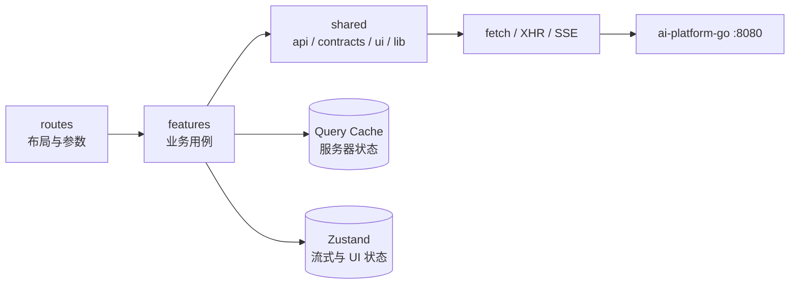
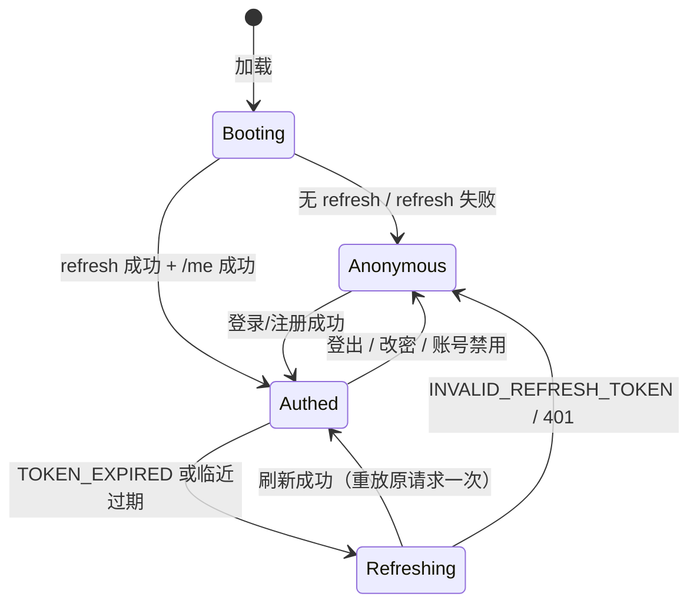

# 01 · 前端技术选型与代码架构

> 定位：`web/` 是 AI Assistant 的唯一 Web 客户端，**只消费 `ai-platform-go` 网关的 `/api/v1`**，不直连
> `ai-platform`（Python 侧要求 `aud=ai-platform` 的 JWT、且 CORS 未对浏览器开放）。
> 本文每条约束都标注了出处；与代码冲突时以代码为准，并回写本文。
>
> 适用范围：M1–M7（见 §7）。不含移动端原生 App、营销页、支付。

---

## 0. 决策速览

| 领域 | 选择 | 一句话理由 |
| --- | --- | --- |
| 形态 | **Vite SPA**（React 19 + TS 5.x） | 全部页面登录后可见，无 SEO/SSR 需求；不引入第二个 Node 常驻进程 |
| 路由 | **TanStack Router** | 类型安全的 search params（`?c=` / `?tab=`），文件路由 + 按路由拆包 |
| 服务器状态 | **TanStack Query v5** | 游标分页、轮询、失效矩阵、缓存，全是后端契约直接需要的 |
| 客户端状态 | **Zustand v5** | 流式 token 高频更新只需极窄订阅；不需要 Redux 的规模 |
| 样式 / 组件 | **Tailwind CSS v4 + shadcn/ui（Radix）** | 设计可控、可访问性由 Radix 兜底、组件代码归自己 |
| Markdown | **react-markdown + remark-gfm + rehype-sanitize + KaTeX + Shiki** | 流式增量渲染 + 引用角标 + 代码高亮 |
| 流式 | **fetch + ReadableStream + `eventsource-parser`** | `EventSource` 不能发 POST、不能带 `Authorization`（决定性约束） |
| 契约 | **Zod 4**（网关手写）+ **openapi-typescript**（AI 侧生成） | 网关没有 OpenAPI；两侧都必须能在运行时被校验 |
| 表单 | **react-hook-form + @hookform/resolvers** | 错误码 `details.fields[]` 可直接落到字段 |
| 图表 | **Recharts** | 只为用量图；按需加载 |
| 测试 | **Vitest + Testing Library + MSW 2 + Playwright** | SSE 用 `ReadableStream` 假流做确定性断言 |
| 工程 | **Biome 2 + pnpm 10 + Node ≥ 22**（本机 Node 24.16 / pnpm 10.15） | 一个二进制同时管 lint 与 format，少一层插件冲突 |

**三条不妥协**

1. 流式**绝不能**用 `EventSource`：接口是 `POST /conversations/{id}/messages/stream`，且要带
   `Authorization: Bearer`（[`http.go`](../../ai-platform-go/internal/server/http.go) 的 `registerMessages`）。
2. `access_token` **只存内存**，`refresh_token` **只存 HttpOnly Cookie**（B-08），且**刷新必须单飞**：refresh 是轮换且非幂等，
   并发刷新会让其中一个请求拿到已作废的令牌（[`docs/02` §3.1 / §7](../../ai-platform-go/docs/02-接口规范与鉴权.md)）。
3. 流断了**不重放**：以消息台账（`GET .../messages`）为准做对账。网关已经替你落了 `partial` 消息，
   重放只会把正文拼两遍。

---

## 1. 现状约束（前端视角）

先把「后端已经定死的东西」列清楚，架构是从这些约束里长出来的，不是从框架偏好里长出来的。

| # | 事实 | 出处 | 前端后果 |
| --- | --- | --- | --- |
| 1 | 所有业务接口在 `/api/v1` 下，除 `/health/*`、`/auth/{register,login,refresh}` 外都要 `Authorization: Bearer` | `docs/02` §1.1 | 一个统一的 `request()` 包装，默认带令牌 |
| 2 | access 30 分钟；refresh 30 天、不透明串、**每次刷新轮换** | `docs/02` §3.1 | 内存存 access；刷新单飞；刷新失败即硬登出 |
| 3 | 流式接口是 `POST` + `text/event-stream`，首帧前可回 JSON 错误、首帧后只能靠 `event: error` | `service/stream.go:52-63` | **双通道错误处理**：`res.ok` 与流内 `error` 事件都要接 |
| 4 | 事件名固定 9 种：`meta` / `reference` / `token` / `tool_call` / `tool_result` / `usage` / `error` / `done` / `gw_persist_error`，另加 `ping`；未知事件原样透传 | `service/stream.go:208-273` | 事件用可辨识联合；未知事件忽略但要留痕 |
| 5 | 首字节超时 35s、流空闲 150s、整轮上限 360s；心跳 15s；非流式对话 70s；元数据透传 8s；上传 120s | `biz/message_stream.go:25-36`、`docs/04` §3.3 | 骨架屏阈值 35s；客户端看门狗 ≈45s；超长回答有 6 分钟硬上限 |
| 6 | 消息状态 `completed` / `partial` / `failed`；结束原因 `stop` / `length` / `max_steps` / `canceled` | `biz/message.go:29-53` | 「完整 / 半截 / 失败」必须视觉可分，不能都当成功 |
| 7 | 列表统一 `{items, next_cursor, has_more}`，`limit` 默认 20、1..100；消息默认 `order=desc` | `docs/02` §1、`service/listparams.go:57` | `useInfiniteQuery`；首屏取最近 20 条再反转渲染 |
| 8 | 错误信封 `{error:{code,message,details,trace_id,retryable,retry_after}}`，`message` 可直接展示 | `docs/02` §2.2 | 错误归一化成 `ApiError`；`code` 只决定「动作」，不重复写文案 |
| 9 | 配额 6 维（`chat_requests` / `llm_tokens` / `kb_count` / `documents_count` / `storage_bytes` / `concurrency`），429 带 `details`；限流带 `Retry-After` | `docs/02` §5 | 配额条 + 倒计时；429 不自动重试 |
| 10 | **任务进度 SSE 没有挂到网关**（`http.go:231` 明写），且透传 handler 会把整个响应体读完再写回 | `service/proxy.go:48` | 任务只能轮询 `GET /tasks/{id}`；进度条按 2s 轮询 |
| 11 | 文档无下载/预览接口；上传走 multipart（字段 `file` 或 `text`），上限 50MB，成功 202 `{doc_id,task_id,duplicated,…}` | `service/upload.go`、`api/v1/knowledge_bases.py:131-147` | XHR 传进度；上传后轮询任务；预览用「切片抽屉」替代 PDF |
| 12 | 文档状态：`PENDING → PARSING → CHUNKING → EMBEDDING → INDEXED`，失败 `FAILED`，删除 `DELETING` | `app/rag/service.py:56` | 状态机渲染；只有 `INDEXED` 才允许看切片/检索 |
| 13 | CORS 白名单默认 `http://localhost:3000,http://127.0.0.1:3000`，暴露 `X-Request-Id` / `X-Trace-Id` / `Retry-After` | `ai-platform-go/.env`、`middleware/cors.go` | dev 端口固定 3000；错误卡片能显示 `trace_id` |
| 14 | 网关没有 OpenAPI；Python 有 `/openapi.json` | `docs/02` §1 | 网关资源（认证/会话/消息/配额）手写 Zod 契约 |
| 15 | `attachments` 非空即拒绝（P2 才做） | `biz/message.go:115` | 不做聊天附件；引导「先传知识库」 |
| 16 | 会话标题 `title_source=auto` 时首轮后可能被改写；`manual` 后不再改写 | `biz/conversation.go:24-27` | `done` 后要失效会话详情与列表，否则侧栏标题不更新 |

---

## 2. 技术选型

### 2.1 为什么是 Vite SPA，不是 Next.js

| 判据 | 本项目 | 结论 |
| --- | --- | --- |
| 首屏内容是否公开 | 全部在登录后 | SSR/SEO 收益为 0 |
| 鉴权形态 | `Authorization` 头 + 内存 access token | SSR 拿不到浏览器内存态；Next 只能加一层 BFF，凭空多一套令牌转发 |
| 流式 | 浏览器 `fetch` + `ReadableStream` | 服务端渲染/路由层都帮不上忙；Next `rewrites` 还可能缓冲 SSE |
| 进程数 | 仓库明确「多一个必须先起的进程」要付代价（Worker 就为此写了整段取舍） | 前端不应再引入一个 Node 常驻进程 |
| 部署 | 静态文件 + nginx 反代 `/api` | 与现有 `docker compose` 基础设施共存最省事 |

**结论**：SPA 静态产物是这套后端的自然客户端形态。若将来要做公开分享页（对话快照），
再单独加一个只读渲染服务，而不是把整个应用搬进 Next。

### 2.2 路由：TanStack Router

- 对话页的一个核心状态是 **URL 里的 `conversationId`**（`/chat/$conversationId`），
  侧栏筛选（`?status=archived&keyword=`）、知识库标签页（`?tab=documents`）也是 URL 状态。
  TanStack Router 的 search params 是**类型化**的，能直接与 Zod 校验器组合，这是选它的主因。
- 文件路由 + `autoCodeSplitting`：Markdown/Shiki/Recharts 天然落在各自路由 chunk 里。
- 备选 **React Router 7**：生态更大、心智更熟，但 search params 要自己写解析与类型；若团队更熟它，
  切换成本仅限于 `routes/` 目录，不影响本文其余分层。
- 不用 **TanStack Start / Remix**：同 §2.1，SSR 无收益。

### 2.3 服务器状态：TanStack Query v5

后端几乎每个列表都是游标分页、几乎每个写操作都有明确的失效对象，这正是 Query 的强项：

- `useInfiniteQuery` + `getNextPageParam: (last) => last.next_cursor`；
- `refetchInterval` 接受函数，任务轮询可在终态自动停（`SUCCEEDED/FAILED/CANCELED`）；
- 失效矩阵集中在一处（§3.10），而不是散落在各组件里手写 `refetch()`；
- 重试只对 `5xx`/网络错误生效，**`4xx` 一律不重试**（配额、限流重试等于自杀）。

不用 SWR：分页与失效能力弱一档；不用自研缓存：这层没有差异化价值。

### 2.4 客户端状态：Zustand

只放三类东西：登录态（内存令牌 + 用户摘要）、流式草稿（当前 turn 的增量正文/工具轨迹/阶段）、
UI 偏好（侧栏折叠、主题、上一次使用的模型与开关）。

不选 Redux：没有跨模块的复杂状态机，也没有时间旅行需求；不选 Context：token 级更新会让整棵树重渲染，
Zustand 的选择器订阅能精确到「只有当前 turn 的正文组件重渲染」。

### 2.5 样式与组件：Tailwind v4 + shadcn/ui

- Ant Design 能更快出表格/表单，但视觉是「后台管理系统」，与 AI 产品的气质不符，且主题定制是逆着库走。
- shadcn/ui 的组件是**复制进仓库的源码**，Radix 负责焦点陷阱、`aria-*`、键盘交互；
  样式用 CSS 变量 + Tailwind v4 的 `@theme`，暗色只切一个 class。
- 代价：没有「开箱即用的复杂组件」（如可编辑表格），需要自己组合。本项目只有文档列表/任务列表两张表，
  用 TanStack Table 或原生 `<table>` 都够。

### 2.6 Markdown 与引用

| 能力 | 选型 | 说明 |
| --- | --- | --- |
| Markdown | `react-markdown` + `remark-gfm` | AST 级处理，便于插入引用节点 |
| 安全 | `rehype-sanitize` | 后端正文来自模型，**必须**当不可信输入；禁止 `dangerouslySetInnerHTML` |
| 公式 | `remark-math` + `rehype-katex` | KaTeX CSS 随 Markdown chunk 懒加载 |
| 代码 | `shiki`（懒加载单例） | 代码块闭合后再高亮；流式期间先纯文本，避免半截 fence 反复重排 |
| 引用角标 | 自写 remark 插件（约 30 行） | 把文本里的 `[n]` 变成 `<citation index={n}>`，与 `references[].index` 对齐 |

引用是这套后端的差异点（[`docs/03` §4.2](../../ai-platform/docs/03-对话与流式输出.md)：
`reference` 帧在首个 `token` 之前到达），所以 UI 上要先出现「正在阅读 N 条资料」的骨架，
再把角标做成可点击 → 右侧资料栏定位到对应 `chunk_id`（`content_sha256` 可用于去重高亮）。

### 2.7 流式：`eventsource-parser`

- `EventSource` 不可用（POST + 自定义头）。
- 不手写 SSE 解析：需要处理 CRLF/LF、`data:` 多行拼接、BOM、半个 UTF-8 字符跨 chunk、
  注释行与 `retry:` 字段——这些正是 `eventsource-parser` 已经做对的。
- 不用 `@microsoft/fetch-event-source`：它把「重连策略」也包了，而本项目**不需要重连**（§3.5.5），
  多一层策略反而会诱导写出「自动重放」的 bug。

### 2.8 契约：Zod + openapi-typescript

后端有两个契约源，前端必须承认这个现实：

| 范围 | 来源 | 做法 |
| --- | --- | --- |
| AI 侧资源（KB / 文档 / 切片 / 检索 / 记忆 / 工具 / MCP / 任务 / 模型 / 上下文） | `ai-platform/openapi.json` | `openapi-typescript` 生成 `shared/api/generated/ai.ts`，**不手改** |
| 网关自有（认证 / 用户 / 配额 / 会话 / 消息 / SSE 帧） | 无 OpenAPI | `shared/contracts/*.ts` 手写 Zod schema，`z.infer` 出类型 |
| SSE 帧 | 无 OpenAPI | `shared/contracts/stream.ts` 手写，逐帧 `safeParse` |

一致性靠**契约测试**兜底（§5）：把 [`docs/14` 的 curl 响应](../../ai-platform/docs/14-接口%20curl%20示例.md)
存成 fixture，用 Zod 解析；字段改名会让测试红，而不是让用户白屏。

不用 tRPC：跨语言（Go/Python），没有共享类型的基础设施；不用 GraphQL：后端是 REST，加一层网关纯属自找。

### 2.9 其余选型

| 项 | 选择 | 理由 |
| --- | --- | --- |
| 表单 | `react-hook-form` + `zodResolver` | 非受控、少重渲染；`details.fields[]` 直接 `setError` |
| 提示 | `sonner` | 轻、支持 Promise toast（上传/保存） |
| 图标 | `lucide-react` | 与 shadcn 同源 |
| 时间 | 原生 `Intl.DateTimeFormat`（`Asia/Shanghai`） | 不引 dayjs；后端全是 RFC3339 UTC，展示层本地化即可 |
| 图表 | `Recharts` | 只用量图；路由级懒加载 |
| 测试 | Vitest + RTL + MSW 2 + Playwright | MSW 可用 `ReadableStream` 造 SSE |
| Lint/Format | Biome 2 | `biome check` 一条命令；不用 ESLint+Prettier 双份配置 |

### 2.10 明确不引入

| 不引入 | 理由 |
| --- | --- |
| Next.js / Remix / TanStack Start | §2.1 |
| Redux Toolkit | 状态规模不需要；devtools 收益低于样板成本 |
| axios | `fetch` + `ReadableStream` 才能读 SSE；上传进度用 XHR，不需要 axios 拦截器 |
| Ant Design / MUI | 视觉与定制成本；shadcn 已覆盖所需原语 |
| `EventSource` 封装库 | 协议不匹配（POST/鉴权） |
| i18n 框架 | 只有 zh-CN；文案集中在 `shared/lib/copy.ts`，将来接 i18n 再迁 |
| IndexedDB / 离线缓存 | 服务端是唯一真源；离线只会制造「消息不同步」的第二真源 |
| WebSocket | 后端按「一轮一个 SSE」设计，没有服务端主动推送通道 |
| 微前端 / pnpm workspace | 单应用单部署；共享类型只有契约层，目录隔离足够 |
| Storybook（首版） | 组件量与团队规模不匹配；等设计系统稳定后再评估 |
| 前端 OTEL SDK | 先用 `X-Request-Id` + `trace_id` 展示；接 Jaeger 深链是 P2 |

### 2.11 如果你更熟 Vue

架构结论不变，映射如下，目录与分层一一对应：

| React 侧 | Vue 3 等价 |
| --- | --- |
| TanStack Router | Vue Router 4（search params 需自写 Zod 解析） |
| TanStack Query | `@tanstack/vue-query` |
| Zustand | Pinia（setup store） |
| react-hook-form | vee-validate + zod |
| react-markdown | `markdown-it` + 自定义 renderer（或 `vue-markdown-render`） |
| shadcn/ui | shadcn-vue（Radix Vue） |

**唯一不建议替换的是「fetch + ReadableStream + eventsource-parser」这一层**，它与框架无关。

---

## 3. 代码架构

### 3.1 目录

```text
web/
├─ index.html
├─ package.json
├─ vite.config.ts
├─ tsconfig.json                 # strict + noUncheckedIndexedAccess
├─ biome.json
├─ .env.example                  # VITE_API_BASE_URL
├─ scripts/
│  ├─ gen-api.mjs                # openapi-typescript 生成 + 漂移检查
│  └─ fetch-openapi.mjs          # 从 127.0.0.1:8000/openapi.json 抓快照
├─ openapi/ai-platform.json      # 提交进仓库的契约快照（可 diff）
├─ e2e/                          # Playwright
└─ src/
   ├─ main.tsx                   # 挂载
   ├─ routeTree.gen.ts           # 路由生成物，不手改
   ├─ routes/                    # 只做「布局 + 参数 + 组合」，不写请求
   ├─ app/                       # 组合根
   │  ├─ providers.tsx           # QueryClient / Theme / Toaster / ErrorBoundary
   │  ├─ query-client.ts
   │  ├─ router.tsx
   │  ├─ bootstrap.ts            # 启动时恢复会话（refresh → /me）
   │  └─ error-boundary.tsx
   ├─ features/
   │  ├─ auth/
   │  ├─ conversations/
   │  ├─ chat/
   │  │  ├─ api.ts
   │  │  ├─ queries.ts
   │  │  ├─ stream/              # 协议 → 状态机 → 控制器
   │  │  │  ├─ types.ts
   │  │  │  ├─ parse.ts
   │  │  │  ├─ reduce.ts
   │  │  │  ├─ controller.ts
   │  │  │  └─ manager.ts        # 与组件生命周期解耦的单例
   │  │  ├─ store.ts
   │  │  ├─ hooks/
   │  │  ├─ components/
   │  │  └─ index.ts             # 该 feature 的公开出口
   │  ├─ knowledge/
   │  ├─ tasks/
   │  ├─ memory/
   │  ├─ quota/
   │  ├─ tools/
   │  └─ inspector/              # 上下文透视（差异化页面）
   ├─ shared/
   │  ├─ api/
   │  │  ├─ client.ts            # fetch 包装
   │  │  ├─ error.ts             # ApiError + 归一化
   │  │  ├─ refresh.ts           # 单飞刷新
   │  │  ├─ sse.ts               # 通用 SSE 读取（chat / 未来 task）
   │  │  ├─ upload.ts            # XHR + 进度
   │  │  ├─ generated/ai.ts      # openapi-typescript 产物，不手改
   │  │  └─ contracts/           # Zod：envelope / auth / conversation /
   │  │                          # message / stream / quota / task / kb
   │  ├─ queries/                # 跨 feature 的只读参考数据（models）
   │  ├─ ui/                     # shadcn 原语 + 应用级复合组件
   │  ├─ hooks/
   │  ├─ lib/                    # cn / format / storage / copy / ids
   │  └─ config/env.ts           # 启动期校验环境变量
   └─ styles/globals.css
```

### 3.2 依赖方向



规则（用 `dependency-cruiser` 或 Biome 的 `noRestrictedImports` 守住，评审时也按这个查）：

1. `routes → features → shared`，**单向**；`shared` 不得 import `features`。
2. feature 之间只能通过对方的 `index.ts` 交互，禁止 `@/features/chat/components/...` 这种深引用。
3. `features/*/api.ts` 只描述端点与契约，**不含 React**；`queries.ts` 只描述缓存键与取数；
   组件只读 hooks，不直接 `fetch`。
4. `shared/api/generated/ai.ts` 与 `routeTree.gen.ts` 是生成物：不进 lint、不手改、CI 检查是否过期。
5. 页面（`routes/`）不出现业务分支：归档判断、配额判断、错误动作都在 feature 内。

### 3.3 四类状态的归属

| 状态 | 例子 | 放在哪 | 为什么 |
| --- | --- | --- | --- |
| 服务器状态 | 会话列表、消息、KB、文档、任务、配额、模型 | **Query cache** | 有失效语义、有游标、要共享 |
| 流式回合状态 | 当前 turn 的正文、引用、工具轨迹、阶段、错误 | **Zustand**（按 `conversationId`） | 高频、短命、只被一个页面用 |
| 会话状态 | access token（内存）、用户摘要、refresh（HttpOnly Cookie，JS 不可读） | **auth store + Query** | 令牌不能进 Query 缓存/持久化 |
| UI / URL | 侧栏折叠、主题、草稿、`?c=`、筛选条件 | **Zustand（persist 仅主题/偏好）/ Router search params** | URL 要可分享、可回退 |

**明确不做**：把消息数组同时放进 Query 和 Zustand。服务器消息只在 Query；流式内容只在 Zustand 的
「临时 turn」里；两者在 UI 层拼接（§3.5.6），`done` 后对账再由 Query 接管。这样可以彻底避免
临时 ID、`seq` 猜测、重复 key 这三类经典 bug。

### 3.4 数据层

#### 3.4.1 统一请求包装

```ts
// shared/api/client.ts
const BASE = import.meta.env.VITE_API_BASE_URL ?? '/api/v1'

export async function request<T>(path: string, opts: RequestOptions = {}): Promise<T> {
  const url = new URL(BASE + path, window.location.origin)
  applyQuery(url, opts.query)

  const headers = new Headers(opts.headers)
  if (opts.json !== undefined) headers.set('Content-Type', 'application/json')
  headers.set('X-Request-Id', `web_${crypto.randomUUID()}`)
  const token = getAccessToken()
  if (token && opts.auth !== false) headers.set('Authorization', `Bearer ${token}`)

  const res = await fetch(url, {
    ...opts,
    headers,
    body: opts.json !== undefined ? JSON.stringify(opts.json) : opts.body,
    signal: opts.signal,
  })

  if (!res.ok) {
    const err = await toApiError(res)                 // 解析统一错误信封
    if (err.code === 'TOKEN_EXPIRED' && opts.retry !== false && token) {
      if (await refreshOnce()) return request<T>(path, { ...opts, retry: false })
    }
    throw err
  }
  if (res.status === 204) return undefined as T
  return (await res.json()) as T
}
```

要点：

- **只对 `TOKEN_EXPIRED` 触发刷新**。`UNAUTHENTICATED` 可能是签名/版本不匹配，刷新也无用；
  `INVALID_REFRESH_TOKEN` 直接硬登出。文档允许 `code` 区分这两者（`docs/02` §3.3）。
- **每个请求带 `X-Request-Id`**：网关会回显（≤128 字符），排障时前后端日志能对上。
- **`retry` 只允许一次**：避免「刷新 → 又 401 → 再刷新」的环。
- 非 2xx 一律 `throw ApiError`；组件不解析 `Response`。

#### 3.4.2 错误归一化

```ts
// shared/api/error.ts
export class ApiError extends Error {
  constructor(readonly init: {
    code: string; message: string; status: number
    details?: Record<string, unknown>
    traceId?: string; retryable?: boolean; retryAfter?: number
  }) { super(init.message) }
  get code() { return this.init.code }
  get status() { return this.init.status }
}

export async function toApiError(res: Response): Promise<ApiError> {
  const traceHeader = res.headers.get('X-Trace-Id') ?? undefined
  const retryAfter = parseRetryAfter(res.headers.get('Retry-After'))
  const body = await res.json().catch(() => null)
  const parsed = ErrorEnvelope.safeParse(body)

  if (!parsed.success) {
    return new ApiError({
      code: 'UNEXPECTED_RESPONSE',
      message: `服务返回了非约定格式（HTTP ${res.status}）`,
      status: res.status, traceId: traceHeader, retryable: res.status >= 500, retryAfter,
    })
  }
  const { error } = parsed.data
  return new ApiError({
    code: error.code, message: error.message, status: res.status,
    details: error.details, traceId: error.trace_id ?? traceHeader,
    retryable: error.retryable, retryAfter: error.retry_after ?? retryAfter,
  })
}
```

**展示规则**：`error.message` 是后端写好的中文用户文案，**优先直接展示**；`code` 只决定「给什么动作按钮」
（重试 / 去登录 / 取消归档 / 查看配额 / 打开上下文）。`trace_id` 收在「技术详情」里可复制，
不占主视觉。

#### 3.4.3 刷新单飞与跨标签

B-08 后 refresh 只存在 HttpOnly Cookie 里，JS 读不到；刷新请求必须带 `credentials: 'include'`，
浏览器自动携带并接收轮换后的 Cookie。

```ts
// shared/api/session.ts
let inflight: Promise<boolean> | null = null

export function refreshOnce(): Promise<boolean> {
  inflight ??= withLock(doRefresh).finally(() => { inflight = null })
  return inflight
}

async function withLock(fn: () => Promise<boolean>): Promise<boolean> {
  // 同一浏览器多标签共享 Cookie，而刷新会轮换它：
  // 没有锁时两个标签会各刷一次，后到的那个必然 401 → 用户被踢出。
  if (!navigator.locks) return fn()
  return navigator.locks.request('auth:refresh', fn) as Promise<boolean>
}

async function doRefresh(): Promise<boolean> {
  const res = await fetch(`${BASE}/auth/refresh`, {
    method: 'POST',
    credentials: 'include',
    headers: { 'Content-Type': 'application/json' },
    body: '{}',
  })
  if (!res.ok) { clearSession('refresh_rejected'); return false }

  const data = await res.json()
  // Cookie 由浏览器保存；JS 只拿 access。
  setAccessToken(data.access_token, data.expires_in)
  return true
}
```

- 启动时：无条件 `POST /auth/refresh`（Cookie 是否存在由服务端判断）→ 成功再 `GET /me`，失败则清态进登录页。
- 主动续期：在 access 过期前 60 秒后台静默刷新，避免「正在输入时突然 401」。
- 退出：`POST /auth/logout`（Cookie 自动携带；`logout_all` 可选）→ 服务端清 Cookie → 清内存 +
  `BroadcastChannel('auth')` 通知其他标签一起退出。
- 改密成功：后端递增 `token_version` 并清 Cookie，前端直接本地登出并提示重新登录。
- `navigator.locks` 只在安全上下文（`https` 或 `localhost`）可用；局域网 HTTP 调试时降级为进程内单飞。

> **安全边界（B-08 已落地）**：refresh 在 `HttpOnly; SameSite=Lax; Path=/api/v1/auth` Cookie 中，
> XSS 不能读取；本地 HTTP 不设 `Secure`，HTTPS/反代 `X-Forwarded-Proto=https` 时自动设置。
> 旧版本残留在 `localStorage['ai.refresh.v1']` 的值会在 `setSession/clearSession` 时清理。

#### 3.4.4 上传（XHR）

`fetch` 没有上传进度，文档上限 50MB（`UPLOAD_MAX_MB`），进度条是必须的：

```ts
// shared/api/upload.ts
export function uploadDocument(kbId: string, form: FormData, onProgress: (pct: number) => void) {
  return new Promise<UploadAccepted>((resolve, reject) => {
    const xhr = new XMLHttpRequest()
    xhr.open('POST', `${BASE}/knowledge-bases/${kbId}/documents`)
    xhr.setRequestHeader('Authorization', `Bearer ${getAccessToken()}`)
    xhr.setRequestHeader('Idempotency-Key', crypto.randomUUID())  // 透传给 AI，重试拿同一个 task_id
    xhr.upload.onprogress = (e) => e.lengthComputable && onProgress(Math.round((e.loaded / e.total) * 100))
    xhr.onload = () => {
      if (xhr.status >= 200 && xhr.status < 300) resolve(JSON.parse(xhr.responseText))
      else reject(parseXhrError(xhr))    // 413 要带 limit_bytes
    }
    xhr.onerror = () => reject(new ApiError({ code: 'NETWORK', message: '上传中断', status: 0 }))
    xhr.send(form)
  })
}
```

上传成功后拿到 `202 {doc_id, task_id, duplicated}`：`duplicated=true` 要提示「相同内容已在处理，复用同一文档」，
而不是当失败。之后轮询任务（§3.11）。

### 3.5 流式链路（核心）

#### 3.5.1 分层

```text
fetch(POST, Bearer)  →  readSSE(协议)  →  parseFrame(校验+映射)  →  reduce(纯函数状态机)
                                                                        │
                    ChatStreamController（副作用：Abort、看门狗、50ms 合帧）│
                                                                        ▼
                                                            Zustand store（按会话）
                                                                        ▼
                                                      UI（消息列表 + 临时 turn）
```

把「协议」「状态机」「副作用」拆开的收益是：前两层是纯函数，能被单测钉死；副作用层只有一处。

#### 3.5.2 事件类型

```ts
// features/chat/stream/types.ts
export type ToolStatus = 'ok' | 'error' | 'timeout' | 'forbidden'

export type ChatEvent =
  | { type: 'meta'; conversationId: string; messageId: string; model: string; createdAt: string; degraded: boolean }
  | { type: 'references'; references: Reference[] }
  | { type: 'token'; delta: string }
  | { type: 'tool_call'; callId: string; name: string; args: Record<string, unknown> }
  | { type: 'tool_result'; callId: string; name: string; status: ToolStatus; summary: string; elapsedMs: number }
  | { type: 'usage'; usage: Usage }
  | { type: 'error'; code: string; message: string; retryable: boolean }
  | { type: 'done'; finishReason: string; elapsedMs: number; partial: boolean }
  | { type: 'persist_error'; reason: string }
  | { type: 'ping' }
  | { type: 'unknown'; event: string; data: unknown }
```

注意 `tool_call.arguments` 是**对象**不是字符串（`stream.go:162-169` 特意归一过），
UI 可以直接当 JSON 渲染；`gw_persist_error` 表示「回答生成成功但台账写入失败」，
要显示一条弱提示（内容仍在，刷新后可能丢），不要当成对话失败。

#### 3.5.3 读取与校验

```ts
// shared/api/sse.ts
export async function readSSE(
  res: Response,
  onFrame: (frame: { event: string; data: string }) => void,
): Promise<void> {
  if (!res.body) throw new Error('响应没有可读流')
  const reader = res.body.getReader()
  const decoder = new TextDecoder()
  const parser = createParser({
    onEvent: (ev) => { if (ev.event) onFrame({ event: ev.event, data: ev.data }) },
  })

  try {
    while (true) {
      const { value, done } = await reader.read()   // fetch 的 signal abort 会让这里 reject
      if (done) break
      parser.feed(decoder.decode(value, { stream: true }))   // UTF-8 跨 chunk 安全
    }
    parser.feed(decoder.decode())                             // flush 尾部
  } finally {
    reader.releaseLock()
  }
}
```

`parseFrame` 做「事件名 → 类型」的映射与 `safeParse`：**单帧校验失败只丢这一帧**，不中断整条流
（与后端「坏帧不中断」的策略对齐，`service/stream.go:88-104`），同时 `console.debug` 留痕。

#### 3.5.4 合帧与渲染节流

一个中文回答可能有上千个 `token` 帧。每帧一次 `setState` 会让 Markdown 重解析上千次：

```ts
private buffer = ''
private timer: number | null = null

private pushDelta(delta: string) {
  this.buffer += delta
  if (this.timer !== null) return
  this.timer = window.setTimeout(() => {   // 50ms ≈ 20fps，肉眼连续且给 React 留出时间
    this.timer = null
    const chunk = this.buffer
    this.buffer = ''
    this.onEvent({ type: 'token', delta: chunk })
  }, 50)
}
```

- 用 `setTimeout` 而非 `requestAnimationFrame`：后台标签页里 rAF 会停，正文会「憋住」直到切回来；
  定时器会被降频，但仍在推进。
- Markdown **按块 memo**：已完成块按内容哈希缓存，只有最后一块每次重解析。
- 滚动：只有用户贴在底部时才跟随（`stickToBottom`），否则显示「有新内容 ↓」，避免抢滚动条。

#### 3.5.5 看门狗与恢复策略

| 情形 | 处理 |
| --- | --- |
| 首帧 35s 未到 | 后端回 `504 AI_TIMEOUT` 信封（`first_byte_timeout`）；前端骨架超时 40s 提示「模型繁忙」 |
| 流中 45s 无任何帧 | 客户端主动 `abort`，按「连接中断」处理——后端 15s 必发 `ping` |
| 整轮超过 360s | 网关以 `AI_TIMEOUT` 终止并落 `partial`；UI 标注「达到单轮时长上限」，建议分段提问 |
| 用户点停止 | `AbortController.abort()`；**不重发**。后端把已生成内容落为 `partial` + `finish_reason=canceled` |
| 网络断开 / 标签刷新 | 不重放。重新进入会话，`GET messages` 会看到 `status=partial` 的半截回答 |
| `gw_persist_error` | 显示弱提示；内容仍在内存，刷新后可能缺失 |
| `error` 帧 | 终止流，渲染错误卡片；若已有部分正文，正文保留并标注「回答中断」 |

**为什么不做断线续传**：SSE 的 `Last-Event-ID` 在网关没有实现，且重放会让客户端把正文拼接两遍；
而消息台账已经持久化了 partial。这条取舍写在这里，防止后来者「顺手加个重连」。

#### 3.5.6 与 Query 的衔接（对账）

UI 渲染 = **服务器消息（Query）** + **临时 turn（Zustand，仅在流式期间存在）**。

```text
发送：setTurn({ phase: 'connecting', userText }) → POST stream
流中：临时 turn 追加正文/引用/工具轨迹
done：await 重新拉取最近一页消息 → 清空临时 turn（同一批次渲染，视觉无缝）
```

- 临时 turn 自己渲染「用户气泡 + 助手气泡」，**不写进消息数组**，所以没有临时 ID、没有 `seq` 猜测。
- `done` 后拉一页（20 条）即可覆盖本轮；`useInfiniteQuery` 用 `maxPages: 2` 控制重取量。
- 对账时同时失效：会话详情（标题可能被改为自动标题）、会话列表、配额（`chat_requests`/`llm_tokens` 已扣）。
- 用户滚到历史中段时到达的 `done` 不强行滚动，只在底部按钮上显示「新回答已生成」。

#### 3.5.7 流与组件生命周期解耦

`manager.ts` 是模块级单例：`start(conversationId, body)` / `stop(conversationId)` / `subscribe`。
好处是用户点侧栏切走页面时，回答继续生成；切回来能立刻看到进度。

两个必须防的坑：

1. **React StrictMode 双挂载**会造成重复 POST（一条用户消息被问两次、扣两次配额）。
   `manager.start` 必须幂等：同一 `conversationId` 已有流时**只订阅不重发**。
2. 登出 / 切换用户时必须 `manager.abortAll()`，否则旧用户的流会把内容写进新用户的界面。

配套交互：侧栏会话项在有活跃流时显示一个呼吸圆点；用户切走后流继续，切回来直接看到进度。
这比「离开即取消」更符合「等一个长回答」的真实使用方式，代价是要处理上面两个生命周期问题。

#### 3.5.8 发送流程（新会话）

后端没有「向新会话发消息」的接口，流式端点路径必须带 `conversation_id`，所以新会话是两步：

```text
POST /conversations  (Idempotency-Key, 可带 title/model/kb_ids)
   → 201 { id }
   → router.replace('/chat/' + id)
   → POST /conversations/{id}/messages/stream
```

- 会话**懒创建**（首条消息才创建），避免侧栏积一堆空「新对话」。
- `Idempotency-Key` 防双击/重试产生两个空会话（24h 内同键返回同一会话，`docs/02` §7）。
- 流式接口**不挂幂等**（`docs/02` §7），所以「发送」按钮在 `connecting|streaming` 期间必须禁用；
  重试要用户显式点，且清楚会产生新消息。

### 3.6 鉴权生命周期



- 路由守卫放在 `_app` 布局：`Booting` 显示启动骨架，`Anonymous` 重定向 `/login?redirect=...`。
- 登录页已登录时反向重定向到 `/chat`。
- 账号被禁用（`USER_DISABLED`）时不重试、不留令牌，直接回登录页并提示。

### 3.7 路由与页面

| 路由 | 页面 | 主要接口 | 关键状态 |
| --- | --- | --- | --- |
| `/login`、`/register` | 登录 / 注册 | `POST /auth/{login,register}` | 字段错误、限流倒计时 |
| `/chat` | 新对话（草稿） | 首次发送时才 `POST /conversations` | 草稿、模型/KB 选择 |
| `/chat/$conversationId` | 对话主界面 | 消息列表、流式发送、归档/改名/置顶 | 流式 turn、引用、工具轨迹 |
| `/knowledge` | 知识库列表 | `GET/POST /knowledge-bases` | 配额 `kb_count` |
| `/knowledge/$kbId` | 知识库详情（文档 + 检索调试） | 文档列表、上传、`POST .../search` | 任务轮询、上传进度 |
| `/tasks` | 任务中心 | `GET /tasks`、cancel/retry | 2s 轮询、终态停 |
| `/memory` | 长期记忆 + 记忆设置 | `/memories*`、`/memory-settings` | 清空确认 |
| `/tools` | 工具 / MCP | `GET /tools`、`GET /mcp/servers` | 生产隐藏 invoke |
| `/settings/profile` | 资料 / 改密 / 登出所有设备 | `PATCH /me`、`POST /auth/password` | 改密后强制重登 |
| `/settings/quota` | 配额与用量 | `GET /me/quota`、`GET /me/usage` | 图表、重置时间 |
| `/settings/appearance` | 主题 / 偏好 | 无 | localStorage |
| `/chat/$conversationId/inspector` | **上下文透视** | `GET .../context`、`GET .../summary`、`POST .../summary/rebuild` | 预算/裁剪/摘要 |

`inspector` 是本项目的展示型页面：后端返回 `budget.used` / `budget.trimmed` 与装配后的消息序列
（`app/schemas/memory.py` 的 `ConversationContextOut`），可以把「模型到底看到了什么、哪些被裁掉」
可视化。这类页面成本低、说服力强。

### 3.8 组件分层

- `shared/ui/*`：无业务语义（Button、Dialog、ScrollArea、Tooltip、EmptyState、ErrorState、Skeleton）。
- `features/*/components/*`：有业务语义（`MessageItem`、`ToolTrace`、`UploadDropzone`、`QuotaMeter`）。
- `routes/*`：只有布局与组合，例如 `ChatPage = <ChatHeader/><MessageList/><Composer/>`。

对话页组件树：

```text
ChatPage
├─ ChatHeader          标题、模型、归档横幅、置顶/改名/归档、Inspector 入口
├─ MessageScroller     粘底、加载更早、回到底部
│  ├─ MessageItem(user)
│  ├─ MessageItem(assistant)
│  │  ├─ DegradedBadge       degraded / degraded_reasons
│  │  ├─ ToolTrace           tool_call → tool_result 时间线（可折叠）
│  │  ├─ Markdown            引用角标 [n] → onCitation(n)
│  │  ├─ ReferenceList       index / doc_name / page / heading / score
│  │  └─ MessageMeta         model / tokens / elapsed_ms / trace_id / partial
│  └─ LiveTurn          来自 Zustand 的临时 turn（与上面同构）
├─ Composer
│  ├─ ComposerTextarea       8000 字符上限，⌘/Ctrl+Enter 发送
│  ├─ RagToggle / MemoryToggle / ToolsToggle（按次发送）
│  ├─ ModelPicker / KbPicker（写回会话：PATCH /conversations/{id}）
│  ├─ AdvancedParams          temperature / top_k / rerank_top_n / score_threshold
│  └─ SendOrStop + QuotaHint
└─ ReferenceRail        右侧资料栏（移动端 Sheet）
```

**一个容易忽略的差异**：`model` 与 `kb_ids` 是**会话字段**（`PATCH /conversations/{id}` 持久化），
而 `use_rag` / `use_memory` / `use_tools` 与采样参数是**单次请求字段**（`SendMessageInput`）。
前者改了就落库、跨刷新保留；后者只在本次生效、用 localStorage 记住「上次的选择」。UI 上要能看出这个区别。

### 3.9 错误码 → 行为

`message` 直接展示；下表只定义**动作**。

| code | 动作 |
| --- | --- |
| `TOKEN_EXPIRED` | 静默刷新 → 重放一次；失败去登录 |
| `UNAUTHENTICATED` / `INVALID_REFRESH_TOKEN` | 清会话，跳登录（带 `redirect`） |
| `INVALID_CREDENTIALS` | 登录表单错误，不区分「账号不存在」 |
| `USER_DISABLED` | 提示禁用，禁止重试 |
| `EMAIL_ALREADY_EXISTS` | 注册字段错误 + 「去登录」 |
| `PERMISSION_DENIED` | 403 空态 |
| `RESOURCE_NOT_FOUND` / `CONVERSATION_NOT_FOUND` / `MESSAGE_NOT_FOUND` | 404 空态 / 回列表 |
| `CONVERSATION_ARCHIVED` | 归档横幅 + 「取消归档」按钮，禁用输入框 |
| `INVALID_ARGUMENT` | 把 `details.fields[]` 映射到表单字段 |
| `PAYLOAD_TOO_LARGE` | 上传/JSON 超限提示（带 `limit_bytes`） |
| `UNSUPPORTED_MEDIA_TYPE` | 上传类型不支持 |
| `QUOTA_EXCEEDED` | 行内配额条：`metric/limit/used/reset_at`，禁用发送至次日 0 点 |
| `RATE_LIMITED` | 按 `Retry-After` 倒计时禁用，toast 一次，不自动重试 |
| `AI_UNAVAILABLE` / `AI_OVERLOADED` / `AI_TIMEOUT` / `DEPENDENCY_UNAVAILABLE` / `INTERNAL_ERROR` | 可重试卡片 + `trace_id` |
| `CONTEXT_TOO_LONG` | 建议新会话 / 关闭记忆，并给「查看上下文」入口 |
| `CONTENT_FILTERED` | 提示改写，不重试 |
| `TOOL_FORBIDDEN` / `TOOL_EXECUTION_FAILED` / `TOOL_TIMEOUT` | 工具轨迹内标红，不打断整轮 |
| `UPSTREAM_LLM_ERROR` / `UPSTREAM_LLM_AUTH_ERROR` / `UPSTREAM_MCP_ERROR` | 展示为「模型/工具服务异常」+ `trace_id` |
| `KB_NOT_FOUND` / `DOCUMENT_NOT_FOUND` / `TASK_NOT_FOUND` / `MEMORY_NOT_FOUND` / `TOOL_NOT_FOUND` / `MCP_SERVER_NOT_FOUND` | 404 空态 / 返回列表 |
| `KB_NAME_CONFLICT` | 表单字段错误 |
| `DOCUMENT_DUPLICATE` | 提示「已存在」，跳转到已有文档 |
| `KB_NOT_EMPTY` | 二次确认「强制删除（含 N 个文档）」，再带 `force=true` |
| `KB_LIMIT_EXCEEDED` / `KB_DOCUMENT_LIMIT_EXCEEDED` | 409 但语义是配额：展示 `kb_count` / `documents_count` 上限 + 「管理配额」入口，不重试 |
| `TASK_NOT_CANCELABLE` / `TASK_NOT_RETRYABLE` | 按钮禁用 + 说明原因 |
| `FILE_TOO_LARGE` / `UNSUPPORTED_FILE_TYPE` / `UNPROCESSABLE_DOCUMENT` | 上传行内失败原因（`error.code` 可见） |
| `MCP_SERVER_UNAVAILABLE` / `RETRIEVAL_FAILED` / `OVERLOADED` / `MQ_UNAVAILABLE` | 可重试 |
| `SERVICE_SHUTTING_DOWN` | 「服务正在重启」+ 重试（后端重启/换实例场景） |
| `TASK_TIMEOUT` | 任务行标记超时，提供「重试」 |
| `SUMMARY_UNAVAILABLE` | 空摘要态 + 「生成摘要」按钮 |
| `CHUNK_STRATEGY_INVALID` / `VECTOR_DIM_MISMATCH` | 前者进表单错误；后者展示「索引配置异常」+ `trace_id`，不重试 |
| `AGENT_MAX_STEPS_EXCEEDED` | 网关未暴露 `/agent/run`，正常路径不会出现；出现则按「推理步数用尽」展示 |

`retryable=true` 才显示重试按钮；`retry_after` 存在时按钮变成倒计时。

发送前先看 `GET /me/quota`：`chat_requests.remaining=0` 或 `concurrency.remaining=0` 时直接禁用输入并展示
`reset_at`，不要等 429 再提示。但**仍然必须处理 429**——配额是网关侧权威，前端缓存可能已过期。

### 3.10 缓存键与失效

```ts
export const qk = {
  me: ['me'] as const,
  quota: ['me', 'quota'] as const,
  usage: (range: UsageRange) => ['me', 'usage', range] as const,
  models: ['models'] as const,
  conversations: (f: ConversationFilter) => ['conversations', f] as const,
  conversation: (id: string) => ['conversation', id] as const,
  messages: (id: string) => ['messages', id] as const,
  context: (id: string) => ['context', id] as const,
  summary: (id: string) => ['summary', id] as const,
  kbs: ['kbs'] as const,
  kb: (id: string) => ['kb', id] as const,
  documents: (kbId: string) => ['kb', kbId, 'documents'] as const,
  chunks: (docId: string) => ['document', docId, 'chunks'] as const,
  tasks: (f: TaskFilter) => ['tasks', f] as const,
  task: (id: string) => ['task', id] as const,
  memories: ['memories'] as const,
  memorySettings: ['memory-settings'] as const,
  tools: ['tools'] as const,
  mcpServers: ['mcp', 'servers'] as const,
}
```

| 触发 | 失效 |
| --- | --- |
| 流式 `done` | `messages(id)`、`conversation(id)`、`conversations(*)`、`quota` |
| 创建会话 | `conversations(*)`（`chat_requests` 在发送消息时才扣，不在创建时） |
| 改名 / 置顶 / 归档 | `conversation(id)`、`conversations(*)` |
| 删除消息 | `messages(id)`、`conversation(id)` |
| 删除会话 | `conversations(*)` |
| 上传受理 / 任务完成 | `documents(kbId)`、`kb(kbId)`、`kbs`、`quota` |
| 删除文档 / KB | 同上 + `tasks` |
| 记忆增删改 / 清空 | `memories`、`memorySettings` |
| 改密 | 清空全部（`queryClient.clear()`）+ 登出 |
| 任务 cancel/retry | `task(id)`、`tasks(*)` |

Query 默认值：`staleTime: 30s`、`gcTime: 5min`、`refetchOnWindowFocus: false`（避免切窗口就重取消息打断阅读）、
`retry` 只对 5xx/网络错误生效且最多 2 次。

### 3.11 轮询：任务与文档

```ts
const TERMINAL = new Set(['SUCCEEDED', 'FAILED', 'CANCELED'])

useQuery({
  queryKey: qk.task(taskId),
  queryFn: () => getTask(taskId),
  refetchInterval: (q) => (TERMINAL.has(q.state.data?.status ?? '') ? false : 2000),
  refetchIntervalInBackground: false,
})
```

- 任务状态机 `PENDING → QUEUED → RUNNING → SUCCEEDED|FAILED|CANCELED`；`RUNNING` 期间 `progress`/`stage`
  可直接做进度条。
- 同一页面有多个任务时，用**一个** `GET /tasks?status=QUEUED&status=RUNNING` 的列表轮询（5s）驱动所有行，
  不要每个任务一个定时器（限流与连接数都不划算）。
- 文档状态另有 `PARSING/CHUNKING/EMBEDDING` 中间态：任务完成后再拉一次文档列表即可。
- 页面不可见时 `refetchIntervalInBackground: false`，避免后台标签页常驻请求。

### 3.12 幂等

| 操作 | `Idempotency-Key` |
| --- | --- |
| 创建会话 | 必须（防双击产生空会话） |
| 非流式发消息 | 必须（本前端主链路用流式，非流式只作降级） |
| 上传文档 | 必须（透传给 AI，重试复用同一 `task_id`） |
| 流式发消息 | 不适用（后端不挂幂等；靠 UI 禁用按钮） |
| 其它写操作 | 不加（归档/删除本身幂等） |

键用 `crypto.randomUUID()`，**在用户动作发生时生成一次**并保存到本次 mutation 的变量里；
不要在重试时重新生成（那就失去幂等意义）。

### 3.13 性能预算

| 指标 | 预算 | 手段 |
| --- | --- | --- |
| 首屏 JS（gzip） | ≤ 180 KB | 路由级拆包；Markdown/Shiki/Recharts 懒加载 |
| 首屏 CSS（gzip） | ≤ 40 KB | Tailwind JIT + 只引 shadcn 用到的组件 |
| 点击会话 → 历史可见 | ≤ 300 ms | 缓存优先 + 骨架；消息页 `staleTime` 30s |
| 首 token → 首字可见 | ≤ 100 ms | 50ms 合帧 + 最后一块 Markdown 增量解析 |
| 流式期间主线程长任务 | < 50 ms | 代码高亮延后到 `done`；引用栏虚拟化（>50 条时） |
| 长会话（>200 条） | 滚动 60fps | `content-visibility: auto` + 稳定的 `key=message.id` |

不做消息虚拟列表首版：200 条以内 DOM 成本可接受，虚拟列表会带来「测量/锚点/复制」一堆边界，
等真实数据证明需要再上 TanStack Virtual。

### 3.14 可访问性与交互

- `aria-live="polite"` 只在 `done` / `error` 时播报整段，**不要**逐 token 播报（读屏会被刷屏）。
- `aria-busy` 标记流式中的消息区；停止按钮 `aria-label="停止生成"`。
- 键盘：`⌘/Ctrl+Enter` 发送、`Esc` 停止、`⌘/Ctrl+K` 新建对话、`⌘/Ctrl+Shift+C` 复制最后一条回答。
- 焦点：路由切换后聚焦主标题；错误卡片出现时聚焦卡片（`tabIndex=-1`）。
- 动效：尊重 `prefers-reduced-motion`（关闭光标闪烁与气泡入场）。
- 对比度：正文 ≥ 4.5:1，`muted` 文本 ≥ 4.5:1（不要用 40% 透明灰）。
- 复制：代码块、整条回答、引用片段、`trace_id` 都要有独立复制按钮与「已复制」反馈。

### 3.15 设计系统

- 颜色用 OKLCH CSS 变量：`--bg / --surface / --elevated / --border / --text / --muted / --accent / --danger / --success / --warning`。
- 暗色为默认，亮色同变量切换；`class="dark"` 挂在 `<html>`。
- 布局：左栏 280px（可折叠 64px）、主区流式宽度 `min(920px, 100%)`、右侧资料栏 340px（≥1280px 显示，否则 Sheet）。
- 对话视觉：用户消息右对齐、`--accent` 低饱和底；助手消息通栏 Markdown，不加气泡（长文阅读更顺）。
- 状态色语义固定：`partial` = 琥珀、`failed` = 红、`degraded` = 蓝灰、`streaming` = 呼吸光标。
- 字体：`system-ui` + `"Noto Sans SC"` 回退；代码 `ui-monospace, "JetBrains Mono"`。

### 3.16 可观测与排障

- **每个请求一个 `X-Request-Id`**（`web_<uuid>`），网关回显；`ApiError.traceId` 优先取响应体里的
  `error.trace_id`（AI 侧透传的值），没有才取 `X-Trace-Id`。
- 错误卡片默认只展示 `message` + 动作；「技术详情」折叠区放 `code / status / trace_id / request_id`，
  一键复制。用户反馈问题时只需要贴这一段。
- 日志只在前端本地：`[api]` / `[sse]` / `[stream]` 前缀，`console.debug` 级别；**禁止**打印令牌与完整消息正文。
- 不做第三方埋点与前端错误上报（没有接收端，也避免隐私问题）；接入 Sentry/自建收集端是 P2。
- 可选增强：请求头已允许 `traceparent`（CORS 白名单），后续可用 Web OTEL SDK 生成以「用户点击」为根的
  trace，在 Jaeger 里与网关、Python 的 span 串起来。首版不做，先靠 `trace_id` 手工关联。
- 路由级 `errorElement` + 全局 ErrorBoundary：渲染异常不白屏，提供「重试 / 回首页 / 复制错误」。

---

## 4. 后端能力缺口与前端对策

> 逐项方案、优先级、契约影响与验收方式见 [`02-前端驱动的后端优化清单`](./02-前端驱动的后端优化清单.md)；
> 本节只保留「缺口 → 前端对策」的速查。

| # | 缺口 | 证据 | 前端对策 | 建议（按性价比排序） |
| --- | --- | --- | --- | --- |
| 1 | 任务进度 SSE 未挂网关；透传 handler 全量缓冲 | `http.go:231`、`proxy.go:48` | 轮询 `GET /tasks/{id}`（2s） | 加一条**流式**透传路由：`io.Copy` + 逐块 Flush，不走 `resp.Body` 缓冲 |
| 2 | 文档无下载/预览（presigned URL 是 P2） | `docs/09` UP-08 | 用「切片抽屉」展示 `chunk`，不做 PDF 预览 | `GET /documents/{id}/download` 302 到 presigned URL |
| 3 | 无「重新生成 / 编辑消息」 | 路由表无此端点 | 只能重发（会产生新消息），UI 明确提示 | `POST /conversations/{id}/messages/{msgId}/regenerate` |
| 4 | 聊天不支持附件 | `biz/message.go:115` | 不渲染附件按钮；空态引导「先上传到知识库」 | 与 UP-08 一起做 |
| 5 | 网关无 OpenAPI | `docs/02` §1 | 手写 Zod + 契约 fixture 测试 | 网关暴露 `/openapi.json`，前端切换生成 |
| 6 | ~~刷新令牌只能放 localStorage~~ | ~~refresh 是请求体参数~~ | B-08 已改为 HttpOnly `ai_refresh` Cookie；见 §3.4.3 | ~~Cookie + CSRF~~ 已完成 |
| 7 | 无配额升级/支付 | `plan` 只读 | 只展示额度与 `reset_at`，不放假按钮 | 产品决策后再做 |
| 8 | 会话搜索只有 `keyword` 过滤，无全文检索 | `ListConversationsInput` | 侧栏搜索走 `GET /conversations?keyword=`，不做本地全文 | 若要做，后端加 FTS |
| 9 | 无未读数/通知 | 无端点 | 不做 | 不必要 |
| 10 | 删除消息不影响 AI 上下文 | `docs/03` §6 | 删除确认里明写「仅删台账，不影响模型记忆」 | 后端可提供「同步删除上下文」选项 |

---

## 5. 测试与质量门禁

| 层 | 工具 | 覆盖什么 |
| --- | --- | --- |
| 单元 | Vitest | `parseFrame`（拆包/CRLF/多行 data/未知事件）、`reduce`、`toApiError`、`refreshOnce` 并发、引用插件、格式化 |
| 组件 | RTL | Composer 禁用态、错误卡片动作、引用角标跳转、归档横幅 |
| 集成 | Vitest + MSW | 登录→刷新→重放；SSE 假流（`ReadableStream` 分片定时 enqueue）；任务轮询终态停止；上传 413 |
| 契约 | Vitest + fixture | `docs/14` 的真实响应逐条 `safeParse`；`openapi/ai-platform.json` 与生成物一致性 |
| E2E | Playwright | 注册→登录→新建会话→流式回答→停止→刷新恢复→知识库上传→任务完成 |

MSW 假流的最小形态：

```ts
http.post('/api/v1/conversations/:id/messages/stream', () => {
  const enc = new TextEncoder()
  const body = new ReadableStream({
    async start(ctrl) {
      const frames = [frame('meta', meta), frame('reference', refs), frame('token', { delta: '你好' }), frame('done', done)]
      for (const f of frames) {
        ctrl.enqueue(enc.encode(f))
        await sleep(10)             // 让客户端分片读到，覆盖「半帧」路径
      }
      ctrl.close()
    },
  })
  return new Response(body, { headers: { 'Content-Type': 'text/event-stream' } })
})
```

门禁命令（与后端 `ruff/mypy/pytest` 对齐的角色）：

```powershell
pnpm typecheck     # tsc --noEmit -p tsconfig.app.json
pnpm lint          # biome check .
pnpm test          # vitest run --coverage
pnpm build         # tsc -b && vite build
pnpm e2e           # playwright test（需两侧服务）
```

覆盖率门槛只对 `features/chat/stream/**` 与 `shared/api/**` 设 90%，不搞全局数字摊派。

---

## 6. 构建与部署

### 6.1 环境变量（构建期）

```dotenv
# .env.example
VITE_API_BASE_URL=/api/v1          # 生产同源；开发走 Vite 代理，无需 CORS
VITE_DEV_PROXY_TARGET=http://127.0.0.1:8080
```

构建期注入意味着「换后端地址要重新构建」。首版接受这个约束；若将来要做多环境同包，再引入
`/config.js` 运行时配置（`window.__APP_CONFIG__`），代价是首屏多一次同步脚本。

### 6.2 Vite 配置要点

```ts
export default defineConfig({
  plugins: [react(), tailwindcss(), tanstackRouter({ target: 'react', autoCodeSplitting: true })],
  server: {
    port: 3000,                                    // 与 CORS 白名单一致
    proxy: { '/api': { target: 'http://127.0.0.1:8080', changeOrigin: true } },
  },
  build: { target: 'es2022', sourcemap: true },
})
```

开发走代理的好处：**同源，无 CORS、无预检**，与生产形态一致；SSE 经 Vite 的 http-proxy 是流式转发的，
但生产 nginx 必须显式关缓冲。

### 6.3 nginx

```nginx
server {
  listen 80;
  root /usr/share/nginx/html;
  index index.html;

  add_header X-Content-Type-Options nosniff always;
  add_header Referrer-Policy strict-origin-when-cross-origin always;

  # 注意：location 里一旦出现 add_header 就不再继承 server 级 add_header，
  # 因此这里用 expires 而不是 add_header 设置缓存策略。
  location /assets/ { expires 1y; }
  location = /index.html { expires -1; }        # 等价于 Cache-Control: no-cache
  location / { try_files $uri $uri/ /index.html; }

  location /api/ {
    proxy_pass http://127.0.0.1:8080;
    proxy_http_version 1.1;
    proxy_set_header Host $host;
    # 覆盖而不是追加：客户端自带的 X-Forwarded-For 不可信
    proxy_set_header X-Forwarded-For $remote_addr;
    proxy_buffering off;          # SSE 必需（后端也发了 X-Accel-Buffering: no）
    proxy_cache off;
    proxy_read_timeout 600s;      # 长回答；后端自己有 15s 心跳
  }
}
```

反向代理要**覆盖** `X-Forwarded-For`。网关按 `TrustedProxyCount` 取真实 IP，但代理层不应把客户端
自带的头透进来——否则限流的 IP 维度会先被伪造头污染。

### 6.4 安全头（CSP 起点）

```nginx
add_header Content-Security-Policy "default-src 'self'; connect-src 'self'; img-src 'self' data: blob:; style-src 'self' 'unsafe-inline'; font-src 'self'; object-src 'none'; base-uri 'none'; frame-ancestors 'none'" always;
```

Tailwind 与 shadcn 的少量内联样式需要 `style-src 'unsafe-inline'`；若把主题变量全部收进 CSS 文件可去掉它。
`connect-src 'self'` 成立的前提是生产走同源 `/api` 代理。

---

## 7. 实施路线

| 里程碑 | 交付 | 验收（可机械检查） |
| --- | --- | --- |
| **M0 脚手架** | Vite + TS + Tailwind + Biome + Vitest；`request` 骨架；路由空壳 | `pnpm build`、`pnpm typecheck`、`pnpm test` 全绿；首屏 < 180KB |
| **M1 认证** | 登录/注册/启动恢复/刷新单飞/登出/改密 | 刷新页面仍登录；三个并发 401 只发一次 `/auth/refresh`；旧 refresh 重放被拒后回登录 |
| **M2 会话与历史** | 列表（游标/归档/搜索/置顶）、会话页、消息倒序分页、删除 | 55 条会话翻 3 页无重复；归档会话输入框禁用；删除消息后列表一致 |
| **M3 流式对话** | SSE 全事件、Markdown、引用角标、停止、断线恢复 | 首帧 200ms 内出骨架；停止后刷新看到 `partial`；StrictMode 下不重复发送 |
| **M4 Agent 与降级** | 工具轨迹时间线、`degraded` 原因、`usage`、`gw_persist_error` | 工具失败仍完整展示轨迹；`max_steps` 有明确结束说明 |
| **M5 知识库与任务** | KB CRUD、上传进度、任务轮询、切片抽屉、检索调试、`truncated` 警告 | 50MB 被本地拦截；`duplicated` 不当失败；终态停止轮询 |
| **M6 记忆 / 配额 / 工具** | 记忆 CRUD + 设置、配额仪表盘 + 用量图、工具/MCP 面板 | 清空记忆需二次确认；配额 429 后发送按钮禁用至 `reset_at` |
| **M7 透视与质量** | 上下文透视、摘要重建、a11y、E2E、错误码全覆盖 | 键盘可完成一次完整对话；所有 `code` 都有动作或明确「无动作」 |

M0–M3 是主干，可以先跑通「登录 → 提问 → 流式回答」再补管理页；M4 之后才是这个项目的差异化部分。

---

## 8. 风险与待决

| 风险 | 影响 | 缓解 |
| --- | --- | --- |
| Markdown 流式渲染卡顿（长回答） | 掉帧、输入卡 | 50ms 合帧、块级 memo、代码高亮延后、必要时降级为纯文本渲染 |
| 契约漂移（网关手写类型） | 运行时字段缺失/白屏 | Zod `safeParse` + 契约 fixture + 生成物 diff 检查 |
| refresh 轮换 + 多标签 | 随机被登出 | Web Locks + 锁内重读 + BroadcastChannel 同步登出 |
| SSE 经代理被缓冲 | 「流式」退化为整段返回 | dev 代理与 nginx 都关缓冲；验收以「首字时间」而非总时长 |
| 任务轮询频率高 | 全局 QPS 与日志噪音 | 列表级单轮询 + 终态停止 + 后台停轮询 |
| 误把 `partial` 当成功 | 用户以为答案完整 | 状态徽标 + 「回答中断」提示 + 重发入口 |
| React 19 / TanStack 版本较新 | 生态兼容问题 | 锁 `pnpm-lock.yaml`；升级单独 PR，先跑契约与 E2E |

**待决（需要产品/后端拍板）**

1. 是否补「任务 SSE 透传」与「重新生成」两个接口（决定 M5/M4 的交互上限）。
2. ~~是否接受 refresh 放 localStorage 的风险，还是排期做 httpOnly Cookie。~~ → B-08 已完成。
3. 部署形态：nginx 静态托管（本文默认）还是容器内 Node 只做静态服务。
4. 是否需要英文界面（当前按 zh-CN 单语设计）。

---

## 附：本文与后端文档的对应关系

| 本文 | 后端真源 |
| --- | --- |
| §1 #1/#2/#8/#9 | [`ai-platform-go/docs/02-接口规范与鉴权.md`](../../ai-platform-go/docs/02-接口规范与鉴权.md) |
| §1 #3–#6、§3.5 | [`ai-platform/docs/03-对话与流式输出.md`](../../ai-platform/docs/03-对话与流式输出.md)、`internal/service/stream.go` |
| §1 #7、§3.7 | `internal/biz/{conversation,message}.go`、`internal/service/listparams.go` |
| §1 #10–#12 | `internal/server/http.go`、`internal/service/{proxy,upload}.go`、`app/rag/service.py` |
| §4 缺口 | [`ai-platform-go/docs/09-优化清单与实测记录.md`](../../ai-platform-go/docs/09-优化清单与实测记录.md) |
