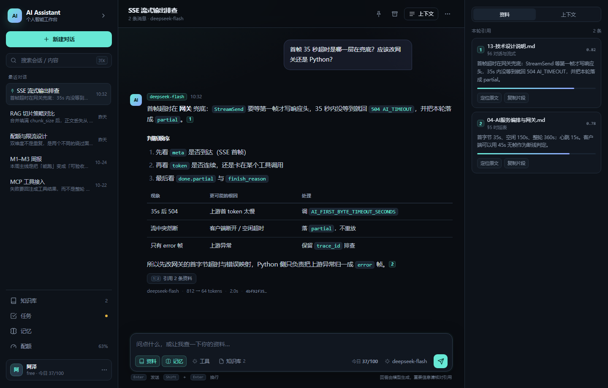
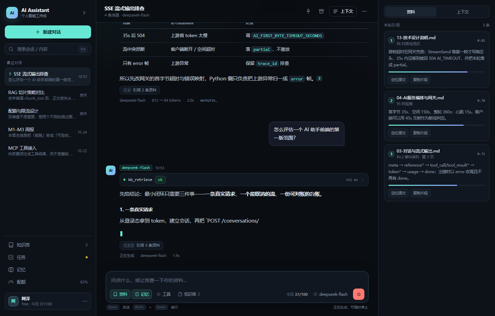
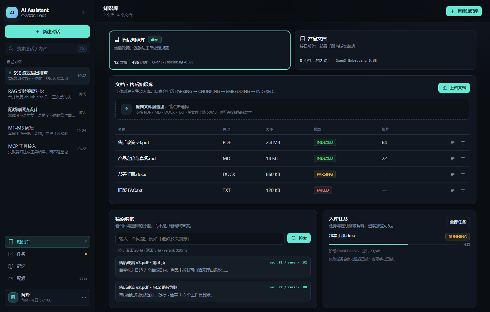
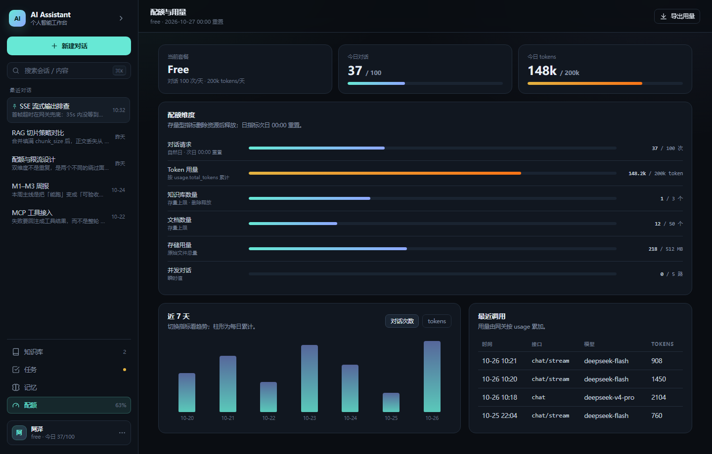

# AI Assistant · 前端静态原型

不接后端、不依赖构建工具的可点击原型。用来先确认**信息架构、视觉方向与关键交互**，
再决定哪些值得落进真实前端。

- 入口：[`index.html`](./index.html)（双击即可打开）
- 技术：纯 HTML / CSS / JS，无网络请求、无第三方依赖
- 页面：登录 · 对话 · 知识库 · 任务 · 记忆 · 配额 · 设置
- 设计依据：[`../docs/01-前端技术选型与代码架构.md`](../docs/01-前端技术选型与代码架构.md)

## 打开

```powershell
# 方式一：直接双击 index.html

# 方式二：起一个静态服务器（推荐，避免个别浏览器的 file:// 限制）
cd web/prototype
python -m http.server 4173
# http://127.0.0.1:4173
```

进入登录页后点「跳过，直接看原型 →」。所有数据都在内存里，刷新即重置。

### URL 参数（方便直接看某个状态）

| 参数 | 作用 |
| --- | --- |
| `?demo=1` | 跳过登录，直接进入应用 |
| `?view=knowledge` | 直接打开某个页面：`chat` / `knowledge` / `tasks` / `memory` / `quota` / `settings` |
| `?ask=1` | 自动发一条消息，演示流式、工具轨迹、引用 |
| `?theme=light` | 直接看亮色主题 |

例：`index.html?demo=1&ask=1`

## 可以点的地方

| 交互 | 在哪 | 看点 |
| --- | --- | --- |
| 流式回答 + 停止 | 对话页发送后 | 逐字输出、工具调用、引用先到、停止后保留 `partial` |
| 引用角标 | 回答里的 `[1]` | 右侧资料卡高亮；窄屏改为弹窗 |
| 工具轨迹 | 回答上方 `kb_retrieve` | 展开看 arguments / result / 耗时 / 状态 |
| 降级标识 | 「RAG 切片策略」会话 | `rerank_skipped` 显示为降级，但回答不失败 |
| 上下文透视 | 顶栏「上下文」/ 右侧「上下文」 | token 预算、被裁掉的历史、装配顺序 |
| 知识库上传 | 知识库页 | 模拟 `PENDING → PARSING → CHUNKING → EMBEDDING → INDEXED` |
| 检索调试 | 知识库页 | 召回 / 返回 / rerank 分差 |
| 任务取消 / 重试 | 任务页 | 取消、重新入队、进度推进 |
| 记忆开关 / 增删 | 记忆页 | 偏好与事实分开、清空二次确认 |
| 配额图表 | 配额页 | 6 个维度、近 7 天柱状图、指标切换 |
| 主题 | 设置页 / 用户菜单 | 暗色 / 亮色设计令牌 |
| 会话操作 | 顶栏 | 置顶、归档、新建、搜索 |

## 页面预览

| 对话 | 流式中 |
| --- | --- |
|  |  |

| 知识库 | 配额 |
| --- | --- |
|  |  |

更多：[登录](./previews/auth.png) · [任务](./previews/tasks.png) · [设置](./previews/settings.png) ·
[亮色](./previews/light.png) · [窄屏](./previews/mobile.png) · [完成态](./previews/done.png)

## 目录

```text
web/prototype/
├─ index.html      # 壳：登录、侧栏、顶栏、主区、右栏
├─ styles.css      # 设计令牌 + 布局 + 组件 + 响应式
├─ app.js          # mock 数据 + 渲染 + 交互 + 模拟流式
└─ previews/       # 已渲染的页面截图
```

## 实现说明

- **视觉**：暗色为默认，亮色通过 `html[data-theme="light"]` 切换 CSS 变量；
  强调色用青绿 + 靛蓝，状态色固定为 `partial=琥珀 / failed=红 / degraded=蓝灰`。
- **布局**：280px 侧栏 + 流式主区 + 340px 资料栏；≤1279px 隐藏右栏，≤980px 侧栏改为抽屉。
- **流式模拟**：`sendMessage → 检索 → 工具调用 → 逐字输出 → done`，停止会把当前内容标为
  `partial · canceled`；对应真实接口的事件序列见 [`../../ai-platform/docs/03`](../../ai-platform/docs/03-对话与流式输出.md)。
- **Markdown**：原型只做了标题、列表、粗体、行内代码、引用角标的简化渲染；
  真实前端按架构文档用 `react-markdown + rehype-sanitize`。
- **状态**：所有页面共用一批内存数组；没有路由库、没有请求层。

## 已知边界

- 不接后端，所有操作都是 mock；刷新页面后数据重置。
- 登录不做校验，目的是快速进入原型。
- 文件上传只模拟状态机，不读取真实文件内容。
- 图表是静态数据；没有接入 `GET /me/usage`。
- 窄屏截图在 Chrome headless 下最小 CSS 视口为 500px；CSS 断点为 560 / 980 / 1279。

## 下一步：接真实 API

按 [`../docs/01`](../docs/01-前端技术选型与代码架构.md) 的 M0–M3：

1. 用 Vite + React + TS 建 `web/`，把 `styles.css` 的设计令牌迁进 Tailwind 变量；
2. 登录/刷新先接 `/auth/*`；
3. 用 `fetch + ReadableStream` 替换 `startMockStream`，事件映射到
   `meta / reference / token / tool_call / tool_result / usage / done / error`；
4. 消息列表从 `GET /messages` 取，临时 turn 只放流式状态；
5. 本原型的组件结构可以直接拆成 `ChatHeader / MessageItem / ToolTrace / ReferenceRail / Composer`。
